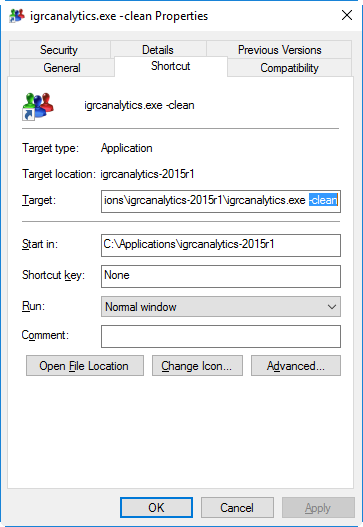

# How-To install and use Microsofts SQL server official driver  

The latest versions of the product no longer comes with the **Oracle** and **Microsoft SQL server** drivers included by default in the installation of the product for licensing reasons. As such, it is now necessary for you to download from the vendor's site the latest version of the driver and to include it in the product.  

## Procedure

### Download the driver

To download the driver navigate to the editors official site : https://www.microsoft.com/en-us/  

Search for the "JDBC drivers for SQL Server". This should display an [MSDN page](https://docs.microsoft.com/en-us/sql/connect/jdbc/microsoft-jdbc-driver-for-sql-server) that will allow you to download the latest version of the JDBC driver for SQL Server:

> [!Note] Please be sure to download the latest version of the JDBC dirvers

> [!warning] We have seen instabilities with older versions of the driver. If your installation uses an older one, replace it with the latest version, keeping the file name expected by the product.

Click "Download" and be sure to download the correct version for your operating system (either Windows, `.exe` file, or Linux, `.tar.gz` file).  

Please follow the installation instruction provided by Microsoft copied bellow :  

### Installation instructions

> [!Note] By downloading the Microsoft JDBC Driver for SQL Server, you are accepting the terms and conditions of the End-User License Agreement (EULA) for this component. Please review the End-User License Agreement (EULA) located on this page and print a copy of the EULA for your records.

#### Installation Instructions for the Microsoft Windows version of the JDBC Driver 

1. Download `sqljdbc_<version>_<language>.exe` to a temporary directory.  
2. Run `sqljdbc_<version>_<language>.exe`.  
3. Enter an installation directory when prompted. We recommend that you unpack this zip file in `%ProgramFiles%` with the default directory: "Microsoft JDBC Driver x.x for SQL Server".  

#### Installation Instructions for the UNIX version of the JDBC Driver

1. Download `sqljdbc_<version>_<language>.tar.gz` to a temporary directory.  
2. To unpack the zipped tar file, navigate to the directory where you want the driver unpacked and type `gzip -d sqljdbc_<version>_<language>.tar.gz`.  
3. To unpack the tar file, move it to the directory where you want the driver installed and type `tar -xf sqljdbc_<version>_<language>.tar`.

This will create a folder containing the different `.jar` files provided by Microsoft. Please use the correct drivers corresponding to your installation of JAVA indicated in the following section.

## Install the driver

### Version 2017 R2 and later

If you are using version 2017 R2 or later please refer to the following article for more information on how to install the driver:  
[How to install SQL server and Oracle JDBC drivers](../install-sql-server-oracle-jdbc-drivers)

### Version 2017 R1 and earlier

Navigate to the following folder in your installation of the product :  

```
<Identity Analytics home installation folder>\plugins\com.brainwave.iaudit.database.drivers_1.0.0\drivers
```

Copy the valid version of the downloaded jar file to the folder and rename the file exactly to the name provided in the **README.txt** file. The valid versions of the drivers depend on the version of JAVA used to run the product.

> [!warning] It is necessary to rename the jar driver as the name of the driver is hard coded in the product.
> **Incorrectly** naming the driver will result in errors.

#### Launch the product

In order for the changes made to the plugins folder to be taken into account it is necessary to launch the product using the `-clean` option.  

This can be done either using the command line by using the following command in a powershell window (you have to run the command from the home installation folder of the product) :  

```sh
.\igrcanalytics.exe -clean
```

Or creating a shortcut where you change the target value to add a `-clean` at the end as displayed in the following caption:  



You can then simply use the product as usual.

## Known limitations

As explained above, it is necessary for you to rename the downloaded driver as this name is hard coded in the product. The driver name can change from version to version so please refer to the **README.txt** file to be sure that the correct name is used.  
