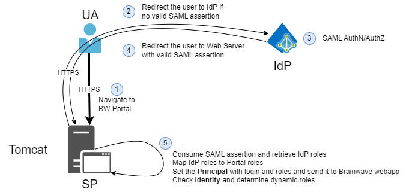
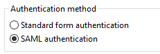

# SAML Access

The SAML authentication mechanism enables the use of a federated identity repository, allowing Tomcat to delegate both authentication and authorization to a third party Identity Provider.

This approach is particularly valuable when an Identity Provider is already deployed within the organization or when the application is intended for use in a cloud-based environment. In such cases, the system relies entirely on the external IdP for identity management.

The Identity Provider does not need to be installed on the Tomcat server itself since it operates as a separate server.

> When authenticating in **federated** mode, the protocol of choice is [SAMLv2](https://wiki.oasis-open.org/security/FrontPage#SAML_V2.0_Standard).

Here is how it works:

- The **User Agent (UA)** is the end user's web browser
- The **Service Provider (SP)** is the Identity Analytics Tomcat web server
- The **Identity Provider (IdP)** is the third party service responsible for authentication and authorization



As you can see here, everything is done through the `HTTP`/`HTTPS` protocol with simple `HTTP redirects` and `HTTP forms`.  
When the user attempts to connect to the service provider, it detects that the user is not authenticated, generates a **challenge** in `SAML` format and redirects the user to the **identity provider** with this challenge.  
The **identity provider** processes the challenge, authenticates the user and redirects the user to the **service provider** with a `response`. The response contains all the required information regarding the user and their **roles**.

The `SAML` challenge/response mechanism involves `XML`, `time stamping` and `XML digital signature` (at a glance, a challenge is sent to the **identity provider**, a response is built by the **identity provider**, it contains the user _identity_, his _roles_, the initial challenge and a validity time frame. The response is **digitally signed** by the identity provider. The response is sent back to the **service provider** which verifies the digital signature, the challenge, the validity time frame and acts accordingly).

Most major vendors, including those listed below, now support the SAMLv2 protocol for user authentication and serve as Identity Providers (IdP):

- Microsoft ADFS
- Google G suite
- Salesforce
- Okta
- InWebo
- LastPass
- OneLogin
- Forgerock
- ...

Identity Analytics provides a **SAMLv2** implementation for Tomcat. For new installations, use the recommended version line for your Tomcat version:

- 4.x for Tomcat 9.0
- 5.x for Tomcat 11.0

The 3.x line remains available for existing Tomcat 9.0 installations but is not recommended for new installations.
This guide explains how to configure SAMLv2 authentication and authorization with a third-party identity provider (IdP).
This implementation is `SAMLv2` compliant and should be used with **any SAMLv2 compliant identity providers** .

## Configuration procedure

### Step 1: Declare the Identity Analytics application in IdP

First step is to declare your Identity Analytics Web application in order for the IdP to recognize it and perform AuthN/AuthZ process for User Agent request coming from the application.

Here are some samples provided by Identity Analytics:

- [Okta](./okta.md)
- [InWebo](./inwebo.md)
- [G-Suite](./gsuite.md)
- [ADFS](./adfs.md)

> [!warning] These samples are provided as examples. This methodology is not supported by Identity Analytics, but has been tested.

Regardless of the IdP solution you choose, an XML metadata file that represents this SP configuration should be generated and provided by the IdP to be deployed in SP side (more on this later in this document).

### Step 2: Deploy SAML configuration in Tomcat

We will use these variables for the configuration:

|         Variable         |                                      Description                                       |          Example value          |
| :----------------------: | :------------------------------------------------------------------------------------: | :-----------------------------: |
| `TOMCAT_INSTALL_FOLDER`  |                            Tomcat installation root folder                             |          /etc/tomcat9/          |
|   `TOMCAT_CONF_FOLDER`   |                    Folder that contains Tomcat configuration files                     |        /etc/tomcat9/conf        |
| `TOMCAT_LIB_FOLDER_HOME` |                 Folder that contains all libraries used by the Tomcat                  |     /usr/share/tomcat9/lib      |
|    `SAML_BW_ARCHIVE`     |              Third-party SAML libraries archive. Unzip it into the Tomcat `lib` folder.               |   tomcat-addons-saml-libs.zip   |
|      `SAML_BW_LIB`       | Identity Analytics JARs that implement SAML authentication. Copy them into the Tomcat `lib` folder. | tomcat-addons-authenticator-saml-4.x.x.jar and tomcat-addons-common-4.x.x.jar |
| `SAML_ROLE_MAPPING_FILE` |             File that contains mapping between AD groups and Portal roles              |     rolemapping.properties      |
| `SAML_IDP_METADATA_FILE` |                XML IdP configuration metadata file provided by the IdP                 |        idp-metadata.xml         |
| `SAML_SP_METADATA_FILE`  |                           XML SP configuration metadata file                           |         sp-metadata.xml         |
| `SAML_STATIC_ROLE_FILE`  |                            File that contains static roles                             |      staticrole.properties      |
|      `WEBAPP_NAME`       |                             Name of the iGRC Tomcat webapp                             |             sandbox             |
|       `WEBAPP_URI`       |                           Identity Analytics Web Portal URI                            |         /sandbox/portal         |
|       `WEBAPP_URL`       |                           Identity Analytics Web Portal URL                            |     <https://localhost:8080>      |

#### Prerequisites

These libraries are not available for direct download. Contact Professional Services or Support to obtain the files for your Tomcat and Java versions.

**4.x (recommended)** — Tomcat 9.0. SAML requires Java 17 or later.

- `tomcat-addons-authenticator-saml-4.x.x.jar`
- `tomcat-addons-common-4.x.x.jar`
- `tomcat-addons-saml-libs.zip`

**5.x (recommended)** — Tomcat 11.0 (Jakarta). Every module, including SAML, requires Java 21 or later. The feature set is the same as 4.x.

- `tomcat-addons-authenticator-saml-5.x.x.jar`
- `tomcat-addons-common-5.x.x.jar`
- `tomcat-addons-saml-libs.zip`

**3.x (not recommended)** — Tomcat 9.0. Kept for existing installations. One library JAR and one SAML archive:

- Java 8: `bw-tomcat-9.0-addons.java1.8-3.x.x.jar` and `bw-tomcat-9.0-saml-libs-<sdk>.zip`
- Java 17 or later: `bw-tomcat-9.0-addons.java17-3.x.x.jar` and `bw-tomcat-9.0-saml-libs-java17-<sdk>.zip`

`<sdk>` is the SAML library version included in that 3.x package. 4.x and 5.x ship a single `tomcat-addons-saml-libs.zip`. There is no separate Java 8 SAML archive and no `-java17` suffix on those lines.

Ensure the following:

- Tomcat instance is installed and available.
- The operator has RW privileges in needed files and folders to proceed with the installation.

> The SAML stack includes OpenSAML, provided under the Apache License, Version 2.0. 4.x and 5.x use OpenSAML 5. On those lines, SHA-1 signatures are rejected and an authentication request is signed with SHA-256 when `sigAlgo` is not set.

#### Tomcat configuration

> If you are using Linux, be mindful of file and folder permissions.

Deploy the libraries into `<TOMCAT_LIB_FOLDER_HOME>`:

- Copy the JAR files (`<SAML_BW_LIB>`) into this folder.
- Unzip `<SAML_BW_ARCHIVE>` into this folder.
- Create a folder `org/apache/catalina/startup`. In this folder, create an `Authenticators.properties` file with the content below.

```properties
# Licensed to the Apache Software Foundation (ASF) under one or more
# contributor license agreements.  See the NOTICE file distributed with
# this work for additional information regarding copyright ownership.
# The ASF licenses this file to You under the Apache License, Version 2.0
# (the "License"); you may not use this file except in compliance with
# the License.  You may obtain a copy of the License at
#
#     http://www.apache.org/licenses/LICENSE-2.0
#
# Unless required by applicable law or agreed to in writing, software
# distributed under the License is distributed on an "AS IS" BASIS,
# WITHOUT WARRANTIES OR CONDITIONS OF ANY KIND, either express or implied.
# See the License for the specific language governing permissions and
# limitations under the License.

BASIC=org.apache.catalina.authenticator.BasicAuthenticator
CLIENT-CERT=org.apache.catalina.authenticator.SSLAuthenticator
DIGEST=org.apache.catalina.authenticator.DigestAuthenticator
FORM=org.apache.catalina.authenticator.FormAuthenticator
NONE=org.apache.catalina.authenticator.NonLoginAuthenticator
SPNEGO=org.apache.catalina.authenticator.SpnegoAuthenticator
SAML=com.brainwave.tomcat.authenticator.saml.SAMLAuthenticator
```

Create `SAMLAuthenticator.properties` in `<TOMCAT_CONF_FOLDER>` (`$CATALINA_BASE/conf`). For a complete example, see [Configuration file samples](#configuration-file-samples). For property descriptions and the version in which each property was introduced, see [SAML Authenticator properties](./saml-authenticators-properties).

Starting with versions **3.4.0**, **4.1.0**, and **5.1.0**, file paths specified in `SAMLAuthenticator.properties` are resolved as follows:

- File names without a directory component, such as `idp-metadata.xml`, `sp-metadata.xml`, or the name of a role-mapping file or keystore, are resolved relative to `$CATALINA_BASE/conf`.
- Absolute paths are used as specified.
- All other relative paths are resolved relative to `$CATALINA_BASE`.

`SAMLAuthenticator.properties` applies to every web application. Since **3.3.10**, and on **4.x** and **5.x**, a web application can use its own file instead: `SAMLAuthenticator-<context-name>.properties`, where `<context-name>` is the context name. That file can point to its own `sp-metadata.xml`. When the context file is absent, `SAMLAuthenticator.properties` is used.

The samples on this page do not sign authentication requests. To sign them, follow [Sign authentication requests](#sign-authentication-requests).

### Step 3: Identity Analytics Portal generation

In your Studio, navigate to the `Export` tab for your project's **technical configuration**:

- Select `SAML authentication`



- Save your technical configuration
- Generate the `<WEBAPP_NAME>` **web portal** using [igrc_portal](../../../02-batch-configuration-and-usage) command line or from the Studio

Once configured, a new `SAML` authentication method is available.

> Note: the SAML method is declared in the `/WEB-INF/web.xml` file under the security configuration in the `auth-method` parameter.

```
<login-config>
<auth-method>SAML</auth-method>
</login-config>
```

If you don't setup `SAML` authentication schema from technical configuration, you won't be able to authenticate via `SAML`.

> The `SAML` configuration is declared in the `<TOMCAT_CONF_FOLDER>/SAMLAuthenticator.properties` file configured earlier.

### Step 4: Deploy Identity Analytics Portal

> If you are using Linux, be mindful of file and folder permissions.

Once your `<WEBAPP_NAME>` webapp is generated, the last step is to:

- Copy it to `<TOMCAT_INSTALL_FOLDER>/webapps` folder
- Start the Tomcat.

The portal should be accessible from your browser using `<WEBAPP_URL>/<WEBAPP_URI>`.

## Sign authentication requests

The service provider supports signing SAML authentication requests starting with version 3.3.7 and in all 4.x and 5.x versions.

Signing is optional. Leave it disabled if the identity provider accepts unsigned requests. The configuration samples below disable signing by setting `AuthnRequestsSigned="false"` and `WantAuthnRequestsSigned="false"`.

Enable signing if the identity provider requires signed authentication requests or if the service provider metadata declares that requests are signed.

For property descriptions and the version in which each property was introduced, see [SAML Authenticator properties](./saml-authenticators-properties).

### 1. Enable signing in the metadata

The authenticator signs authentication requests when either of the following attributes is `true`:

- `AuthnRequestsSigned` on the `SPSSODescriptor` element in `sp-metadata.xml`.
- `WantAuthnRequestsSigned` on the `IDPSSODescriptor` element in `idp-metadata.xml`.

To enable signing through the service provider metadata, update `sp-metadata.xml`:

```
<md:SPSSODescriptor AuthnRequestsSigned="true" WantAssertionsSigned="false" protocolSupportEnumeration="urn:oasis:names:tc:SAML:2.0:protocol">
```

Alternatively, enable signing through `idp-metadata.xml`:

```
<md:IDPSSODescriptor WantAuthnRequestsSigned="true" protocolSupportEnumeration="urn:oasis:names:tc:SAML:2.0:protocol">
```

The identity provider usually supplies `idp-metadata.xml`. Change `WantAuthnRequestsSigned` only if you maintain that file locally. Setting `AuthnRequestsSigned="true"` in `sp-metadata.xml` is sufficient to enable signing for this service provider.

### 2. Create the key pair

Run the following command in `<TOMCAT_CONF_FOLDER>` (`$CATALINA_BASE/conf`):

```
keytool -genkeypair -validity 3000 -keyalg RSA -alias privatekey -keypass changeit -storepass changeit -storetype PKCS12 -keystore samlkeystore.p12
```

When creating and configuring the keystore:

- Set `privateKeyAlias` to the alias specified in the command: `privatekey`.
- Use the same password for the keystore and the private key. Both passwords are `changeit` in this example.
- Set `privateKeystoreFormat=PKCS12` to match `-storetype PKCS12`.
- Answer the certificate questions, or leave the answers empty.

The command stores a self-signed certificate and its private key in the keystore. Keep the certificate in the keystore entry, even after copying it into `sp-metadata.xml`. Starting with versions 4.0.2, 4.1.0, 5.0.2, and 5.1.0, the authenticator reads the certificate from the keystore when signing requests.

#### Version compatibility

In versions 4.0.0, 4.0.1, 5.0.0, and 5.0.1, signed authentication requests fail before reaching the identity provider:

- HTTP-POST returns HTTP 500.
- HTTP-Redirect returns HTTP 403.

Use version 4.0.2 or later for Tomcat 9, or version 5.0.2 or later for Tomcat 11. The 3.x versions are not affected.

#### Keystore permissions and location

Restrict access to the keystore so that the account running Tomcat can read it and other accounts cannot:

- On Linux, use mode `600`, or mode `640` with a group restricted to the required account.
- On Windows, use an ACL restricted to the Tomcat service account.

Starting with versions 3.4.0, 4.1.0, and 5.1.0, `privateKeystore=samlkeystore.p12` resolves to `$CATALINA_BASE/conf/samlkeystore.p12`. Absolute paths are used as specified. All other relative paths are resolved relative to `$CATALINA_BASE`.

### 3. Publish the certificate in the service provider metadata

Export the certificate:

```
keytool -exportcert -rfc -keystore samlkeystore.p12 -storepass changeit -alias privatekey -file samlcert.pem
```

Open `samlcert.pem` and copy the Base64-encoded content between `-----BEGIN CERTIFICATE-----` and `-----END CERTIFICATE-----`. Do not include those two lines.

In `sp-metadata.xml`, add a `KeyDescriptor` element inside `SPSSODescriptor`. Replace the placeholder below with the copied certificate content. The `KeyInfo` element contains the certificate information used to verify signatures. [w3](http://www.w3.org/2000/09/xmldsig)

```
<md:SPSSODescriptor AuthnRequestsSigned="true" WantAssertionsSigned="false" protocolSupportEnumeration="urn:oasis:names:tc:SAML:2.0:protocol">
    <md:KeyDescriptor use="signing">
        <ds:KeyInfo xmlns:ds="http://www.w3.org/2000/09/xmldsig#">
            <ds:X509Data>
                <ds:X509Certificate>REPLACE_WITH_THE_BASE64_CERTIFICATE</ds:X509Certificate>
            </ds:X509Data>
        </ds:KeyInfo>
    </md:KeyDescriptor>
</md:SPSSODescriptor>
```

Provide the updated `sp-metadata.xml` to the identity provider when registering the application so that it can trust the signing certificate.

### 4. Configure the keystore properties

Add the following properties to `SAMLAuthenticator.properties`. The authenticator reads these properties only when signing is enabled.

```
privateKeystore=samlkeystore.p12
privateKeystorePass=changeit
privateKeyAlias=privatekey
privateKeyPass=changeit
privateKeystoreFormat=PKCS12
sigAlgo=rsa-sha256
```

The `sigAlgo` property is optional:

- In 4.x and 5.x, the default is `rsa-sha256`. These versions reject SHA-1.
- In versions 3.3.8 through 3.3.10, the default is `rsa-sha1`.

Restart Tomcat to apply the changes.

## Debug

To enable trace logging for troubleshooting SAML requests and responses, add the following line to the end of `$CATALINA_BASE/conf/logging.properties`:

```
com.brainwave.tomcat.authenticator.saml.SAMLAuthenticator.level = ALL
```

Do not enable this logging in production.

## Configuration file samples

Place the following files in `<TOMCAT_CONF_FOLDER>` (`$CATALINA_BASE/conf`).

Starting with versions 3.4.0, 4.1.0, and 5.1.0, file paths specified in `SAMLAuthenticator.properties` are resolved as follows:

- File names without a directory component are resolved relative to `$CATALINA_BASE/conf`.
- Absolute paths are used as specified.
- All other relative paths are resolved relative to `$CATALINA_BASE`.

For property descriptions and the version in which each property was introduced, see [SAML Authenticator properties](./saml-authenticators-properties).

The private keystore must be readable by the account running Tomcat and inaccessible to other accounts.

### SAMLAuthenticator.properties

```
# SAML Authenticator property file

idpMetadata=idp-metadata.xml
spMetadata=sp-metadata.xml
roleMapping=rolemapping.properties
defaultRoleList=user
staticRole=staticroles.properties
checkRealm=false
roleAttribute=groups
genericUsers=user
genericUserPattern={login} ({generic})
defaultURI=/sandbox/portal
forceURI=/sandbox/portal

# Optional. Use this SAML attribute as the login instead of NameID.
# Available since version 2.1, including in 3.x, 4.x, and 5.x.
# userAttributeIdentifier=

# Uncomment to configure authentication request signing.
# Also enable signing in the metadata. See "Sign authentication requests" above.
# privateKeystore=samlkeystore.p12
# privateKeystorePass=changeit
# privateKeyAlias=privatekey
# privateKeyPass=changeit
# privateKeystoreFormat=PKCS12
# sigAlgo=rsa-sha256
```

### idp-metadata.xml

Replace this sample with the metadata file supplied by the identity provider.

```
<?xml version="1.0" encoding="UTF-8"?>
<md:EntityDescriptor xmlns:md="urn:oasis:names:tc:SAML:2.0:metadata" entityID="https://idp.example.com/saml">
  <md:IDPSSODescriptor WantAuthnRequestsSigned="false" protocolSupportEnumeration="urn:oasis:names:tc:SAML:2.0:protocol">
    <md:KeyDescriptor use="signing">
      <ds:KeyInfo xmlns:ds="http://www.w3.org/2000/09/xmldsig#">
        <ds:X509Data>
          <ds:X509Certificate>REPLACE_WITH_THE_IDP_SIGNING_CERTIFICATE</ds:X509Certificate>
        </ds:X509Data>
      </ds:KeyInfo>
    </md:KeyDescriptor>
    <md:NameIDFormat>urn:oasis:names:tc:SAML:1.1:nameid-format:unspecified</md:NameIDFormat>
    <md:SingleSignOnService Binding="urn:oasis:names:tc:SAML:2.0:bindings:HTTP-POST" Location="https://idp.example.com/sso/saml"/>
    <md:SingleSignOnService Binding="urn:oasis:names:tc:SAML:2.0:bindings:HTTP-Redirect" Location="https://idp.example.com/sso/saml"/>
  </md:IDPSSODescriptor>
</md:EntityDescriptor>
```

### sp-metadata.xml

Update `entityID` and both `Location` values for your deployment. Keep the `/logout` and `/acs` suffixes, and ensure that the application name in each path matches the deployed web application.

```
<?xml version="1.0"?>
<md:EntityDescriptor xmlns:md="urn:oasis:names:tc:SAML:2.0:metadata"
                     validUntil="2099-01-19T13:33:05Z"
                     cacheDuration="PT3153600000S"
                     entityID="brainwavesaml">
    <md:SPSSODescriptor AuthnRequestsSigned="false" WantAssertionsSigned="true" protocolSupportEnumeration="urn:oasis:names:tc:SAML:2.0:protocol">
        <md:SingleLogoutService Binding="urn:oasis:names:tc:SAML:2.0:bindings:HTTP-Redirect"
                                Location="http://localhost:9090/sandbox/logout" />
        <md:NameIDFormat>urn:oasis:names:tc:SAML:1.1:nameid-format:unspecified</md:NameIDFormat>
        <md:AssertionConsumerService Binding="urn:oasis:names:tc:SAML:2.0:bindings:HTTP-POST"
                                     Location="http://localhost:9090/sandbox/acs"
                                     index="1" />
    </md:SPSSODescriptor>
</md:EntityDescriptor>
```

Setting `WantAssertionsSigned="true"` requires signed assertions.

In 4.x and 5.x, the authenticator accepts a response if the response itself is signed or every assertion is signed. However, when `WantAssertionsSigned="true"`, every assertion must be signed even if the response itself is signed.

### rolemapping.properties

Map each role returned by the identity provider to a portal role. Specify the identity provider role on the left and the portal role on the right.

```
Domain Users=user
IGA-Admins=igrc-administrator
```

### staticroles.properties

Optionally, assign static roles using the format `login=role1,role2`.

If static roles are not used, leave the file empty. The `staticRole` property must still reference the file.

```
jdoe@example.com=user,igrc-administrator
```
