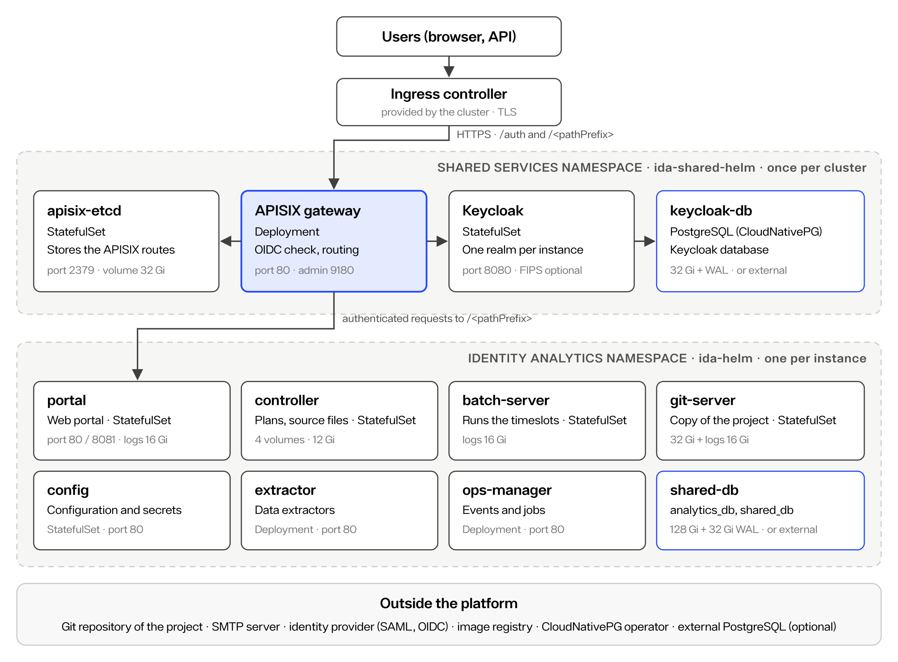

# Architecture

A Self-Managed deployment is made of two Helm releases and one operator. Shared Services are installed once per cluster and provide authentication and the API gateway. Each Identity Analytics instance has its own namespace, its own business services and its own database. All user traffic enters through an ingress, goes through the APISIX gateway, which authenticates it against Keycloak, then reaches the services of the instance.

## Components

### Shared Services (ida-shared-helm)

| Component | Kubernetes object | Port | Storage | Role |
| :-------- | :---------------- | :--- | :------ | :--- |
| `apisix` | Deployment | 80 (gateway), 9180 (admin) | - | API gateway: checks the OIDC session and routes requests to the instances |
| `apisix-etcd` | StatefulSet | 2379 | 32 Gi | Stores the APISIX routes |
| `keycloak` | StatefulSet | 8080 | - | Identity provider. Each Identity Analytics instance has its own realm, named after the instance namespace. |
| `keycloak-db` | CloudNativePG cluster | 5432 | 32 Gi data + 32 Gi WAL | Keycloak database (internal database mode only) |

### Identity Analytics instance (ida-helm)

| Component | Kubernetes object | Port | Storage | Role |
| :-------- | :---------------- | :--- | :------ | :--- |
| `portal` | StatefulSet | 80, 8081 (internal web services) | 16 Gi logs | Web portal |
| `batch-server` | StatefulSet | 80 | 16 Gi logs | Runs the execution plans that load the timeslots |
| `controller` | StatefulSet | 80 | 4 volumes, 12 Gi | Starts and follows the execution plans, receives the source files, keeps their logs |
| `config` | StatefulSet | 80 | - | Configuration store and secrets of the instance |
| `git-server` | StatefulSet | 80 | 32 Gi + 16 Gi logs | Local copy of the Git repository of the project |
| `extractor` | Deployment | 80 | - | Data extractors (for example PowerShell, Entra ID, SailPoint) |
| `ops-manager` | Deployment | 80 (service `events-mngt`) | - | Event handling and operation jobs |
| `shared-db` | CloudNativePG cluster | 5432 | 128 Gi data + 32 Gi WAL | Databases `analytics_db` (Identity Ledger, workflow and audit log schemas) and `shared_db` (controller, configuration, Git sync) |

### Initialisation jobs

Each `helm install` or `helm upgrade` runs jobs that prepare the platform. They end in the `Completed` state:

- Shared Services: `keycloak-master-realm`, `keycloak-update-db`, `apisix-init-config`; in external database mode, `init-external-keycloak-db`.
- Identity Analytics: `config-store-init` (applies the values to the configuration store), `analytics-update-db` (creates or migrates the database schema), `environment-setup` (creates the Keycloak realm and the APISIX routes of the instance); in external database mode, `external-db-init`.

### Optional components

These components are disabled by default and enabled in the values: `aida` and `aiuar` (AI features, with `litellmProxy`), `sqlPad` (SQL console), `metricsService` (Prometheus metrics) and `dataRecovery` (data import, see Data migration).

## Traffic flow

1. Users reach `https://<IDA_DNS>`. The ingress controller of the cluster terminates TLS.
2. Two ingresses, both created in the Shared Services namespace, send the traffic to the `apisix-gateway` service: `/` (including `/auth`, Keycloak) from the Shared Services chart, and `/<pathPrefix>` from the Identity Analytics chart.
3. APISIX redirects unauthenticated users to Keycloak, in the realm of the instance.
4. Authenticated requests are routed to the portal, the configuration interface (`/<pathPrefix>/config`) and the controller (`/<pathPrefix>/controller`).

Inside the cluster, services talk to each other on port 80 (8080 for Keycloak). The platform also needs outbound access to the Git repository of the project, the SMTP server, the identity provider if users log in through SAML or OIDC, and the image registry.

## Databases

The platform needs PostgreSQL for Keycloak and for each Identity Analytics instance. Two modes are available, chosen with `database.type` in each chart:

| Mode | How it works | When to use it |
| :--- | :----------- | :------------- |
| `internal` (default) | The CloudNativePG operator creates `keycloak-db` and `shared-db` inside the cluster, with persistent volumes | Standard case. Backups are configured in the chart. |
| `external` | The charts connect to a PostgreSQL server you provide and create the databases, roles and schemas (`autoInit: true`, required) | Your organisation requires a managed or centrally operated database service. See [External database](./04-external-database.md). |

## Limits

- **One instance per Shared Services component**: Keycloak, APISIX and etcd run with one replica. Multi-instance (high availability) configuration of Shared Services is not supported.
- **One database instance by default**: the built-in PostgreSQL clusters run one instance (`database.instances: 1`) and no backup is configured until you enable it. See Operations, Backup and restore.
- **One namespace per Identity Analytics instance**: the namespace name is also the name of the Keycloak realm of the instance.
