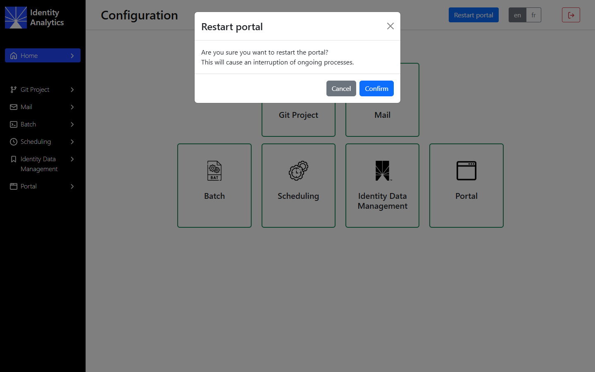
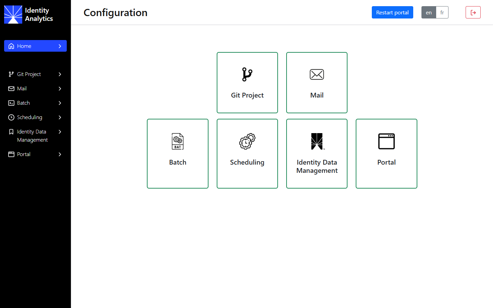
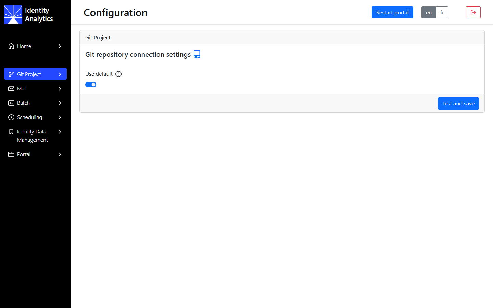
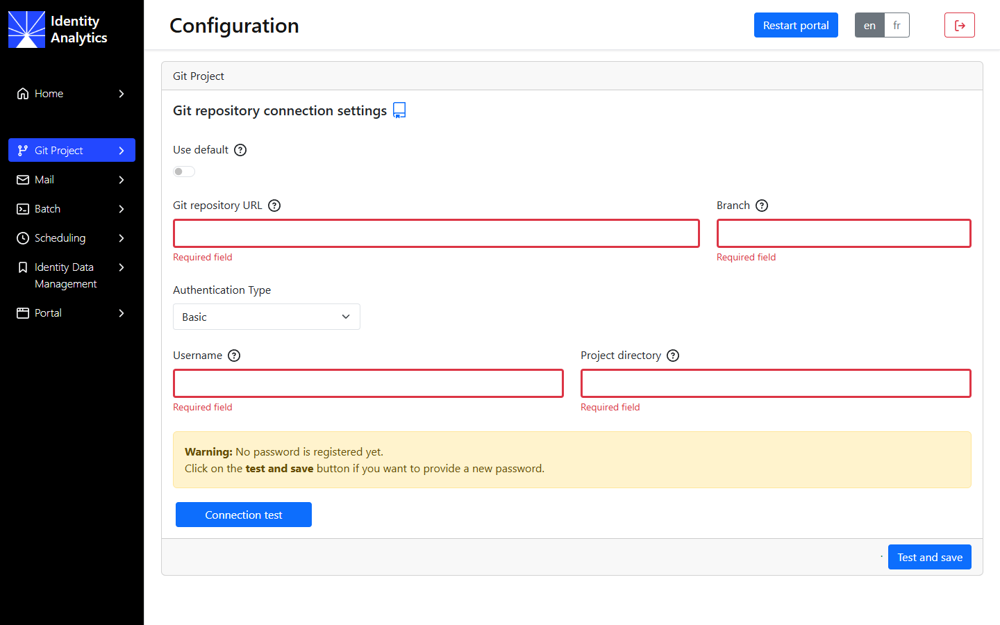
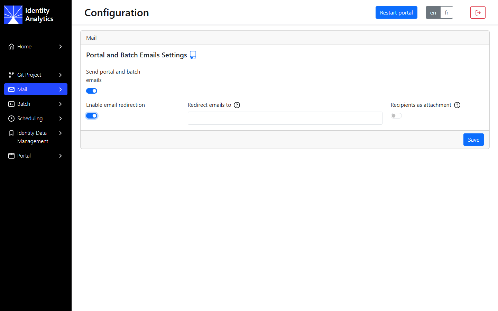
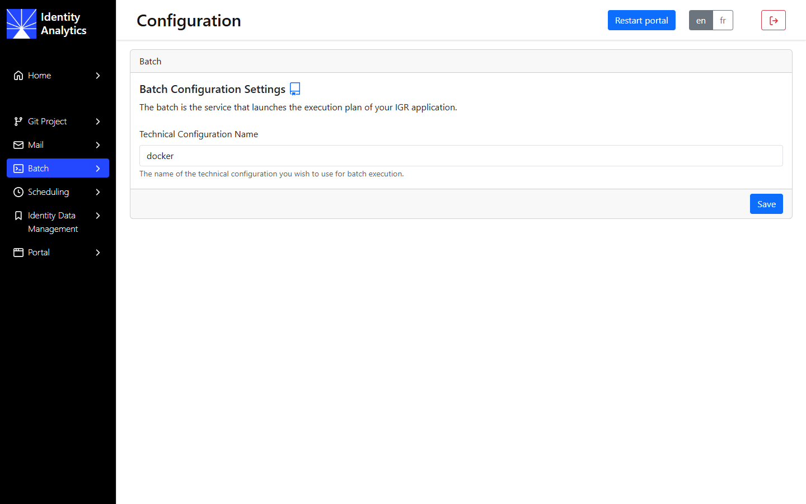
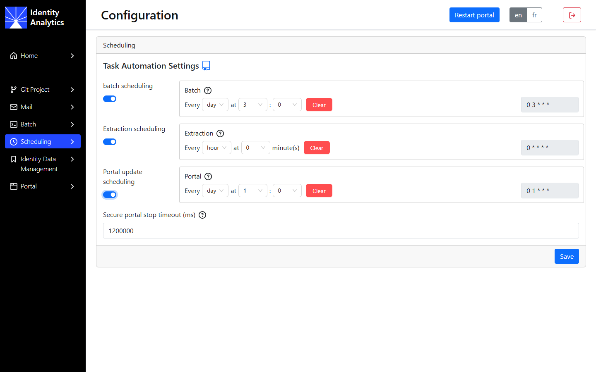
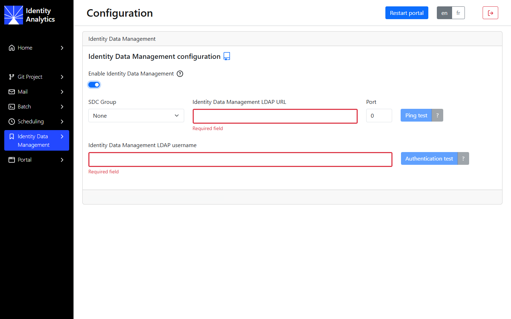
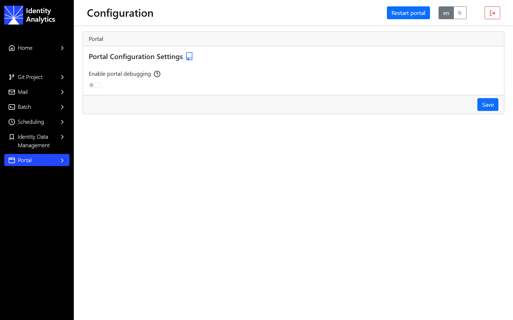

# Identity Analytics configuration interface

The configuration interface holds the functional and technical settings of an instance that are not set by the Helm values: the project repository, the emails of the portal and the batch, the schedules, the Identity Data Management connection and the portal debugging.

## First connection

The configuration interface is available at `https://<IDA_DNS><IDA_PATH>/config`. Log in with the technical administrator account (`setup`) or another account with the `technicaladmin` role.

> [!note] In Self-Managed, the infrastructure settings (DNS name, TLS, database, SMTP server, resources, license) come from the Helm values of the instance and are not displayed in this interface. See [Which setting wins](#which-setting-wins).

Open the pages from the menu on the left or from the tiles of the home page. Direct links to a page (for example `<IDA_PATH>/config/git`) are not supported: go through the menu.

> [!warning] Click **Save** (or **Test and save**) before you leave a page: unsaved changes are lost.

## Which setting wins

Some settings can be set both in the Helm values and in the configuration interface or another console. At each installation and upgrade, the `config-store-init` job writes the values to the configuration store: some settings are written every time, others only at the first installation.

| Setting | Where to set it | At each `helm upgrade` |
| :------ | :-------------- | :--------------------- |
| SMTP (server, port, sender, authentication) | Values `smtp.*` | The values are written again and overwrite changes made in the configuration interface (**Mail** page). The controller only displays these settings (**Email server** tab). The portal and the controller restart when they change. |
| Git repository of the project | Values `git.default.*` | The values are written again and an immediate Git synchronisation is triggered. |
| Other Git repository selected in the configuration interface | Configuration interface | Kept: the instance keeps using the repository selected in the interface. |
| Git synchronisation schedule | Values `gitServer.defaultCron`, first installation only | Not written again. See [Project changes](../11-operations/05-project-changes.md). |
| Identity Data Management (RadiantOne) connection | Values, first installation only | Not written again: later changes made in the configuration interface are kept. |
| License | Values `global.license` (base64), or `global.licenseFile` | The values are applied: to renew the license, run `helm upgrade` with the new license. `global.license` wins over `global.licenseFile`: if your values file contains `global.license`, replace it there. The portal, the batch and the configuration service restart and load it. |
| CPU, memory and Java heap of the pods | Values (`resources`, `jvm.memory` of each component) | The values are applied. |
| Password of the technical administrator (`setup`) | Values `global.technicalAdmin.password`, first installation only | Not written again: change the password in Keycloak. |

Report in your values files any change of a setting written at each upgrade, before you run the next `helm upgrade`.

## Header

The header of every page has three controls:

- **Restart portal** restarts the portal, for example after a change of the project or of a setting of this interface. Confirm the restart: it interrupts the ongoing processes of the portal. The button is disabled while the **Git Project**, **Batch** or **Scheduling** pages have missing required fields.

    

- **en** / **fr** switches the language of the interface.
- The red icon logs you out.

## Home

The home page shows one tile per page: **Git Project**, **Mail**, **Batch**, **Scheduling**, **Identity Data Management** and **Portal**. A tile shows a warning when its page has missing or invalid settings.

## Git Project

This page selects the Git repository of the project.

- **Use default** on: the instance uses the repository, branch and credentials of the Helm values (`git.default.*`). This is the usual setting.
- **Use default** off: enter another repository. Your choice is kept across upgrades.

- **Git repository URL** and **Branch**: the repository and the branch of the project.
- **Authentication Type**: **Basic** (username and password or access token) or **GitHub App**.
- **Username**: the account used to read the repository. The password is requested when you click **Test and save**.
- **Project directory**: the folder of the repository that contains the project, `brainwave` by default.
- **Connection test** checks the connection to the branch with these settings. **Test and save** runs the same test and saves the settings only if it succeeds.

See [Project repository](../02-prerequisites.md#project-repository) for the available repositories and credentials.

## Mail

This page controls the emails sent by the portal and the batch. The SMTP server itself is set by the `smtp.*` values.

- **Send portal and batch emails**: enables or disables these emails.
- **Enable email redirection** and **Redirect emails to**: send all the emails to one address instead of their recipients, for example on an acceptance instance.
- **Recipients as attachment**: when enabled, the list of the recipients is attached to the email.

## Batch

**Technical Configuration Name** is the technical configuration of the project used to run the execution plans (`docker` by default).

## Scheduling

Each switch enables a recurring task; set its frequency with **Every** (day or hour) and **at**. The corresponding cron expression is displayed on the right, and **Clear** removes the schedule.

- **batch scheduling**: starts an execution plan.
- **Extraction scheduling**: runs the connectors declared in the portal.
- **Portal update scheduling**: restarts the portal, so that it loads the last synchronised version of the project (see [Project changes](../11-operations/05-project-changes.md)).
- **Secure portal stop timeout (ms)**: when the portal stops, the time given to the ongoing tasks to complete before the portal is forced to stop.

> [!note] Spread the schedules so that they do not overlap: an execution plan can take a long time, and the portal should not restart during a plan.

## Identity Data Management

This page connects the instance to RadiantOne Identity Data Management. See [Identity Data Management integration](../07-integrations/iddm.md).

- **Enable Identity Data Management**: enables the connection.
- **SDC Group**: the group of the RadiantOne Secure Data Connector, if you use one.
- **Identity Data Management LDAP URL** and **Port**: the LDAP endpoint of Identity Data Management. **Ping test** checks that it can be reached.
- **Identity Data Management LDAP username**: the account used to connect. **Authentication test** checks the connection with this account and its password.

The settings of this page are saved only when the corresponding test succeeds.

## Portal

**Enable portal debugging** displays the debug context in the portal pages. Do not enable it in production.
