# Identity Analytics Configuration

Use the configuration interface to manage instance settings that are not controlled by Helm values. These include the project repository, portal and batch emails, timeslot purging, schedules, database checks, the Identity Data Management connection, and portal debugging.

## Access the interface

The configuration interface is available at `https://<IDA_DNS><IDA_PATH>/config`. Log in with the technical administrator account (`setup`) or another account with the `technicaladmin` role.

> [!note]
> In Self-Managed deployments, Helm values control infrastructure settings such as the DNS name, TLS, database, SMTP server, resources, and license. These settings are not displayed in this interface. See [Configuration precedence](#configuration-precedence).

Use the menu on the left or the home page tiles to navigate between pages. Direct links to individual pages, such as `<IDA_PATH>/config/git`, are not supported.

> [!warning]
> Select Save or Test and save before leaving a page. Unsaved changes are lost.

## Configuration settings

Some settings can be configured through both Helm values and the configuration interface or another console. During installation and upgrades, the `config-store-init` job writes Helm values to the configuration store. Some values are written every time; others are written only during the initial installation. Refer to the table below for further details.

| Setting | Where to configure it | Behavior during `helm upgrade` |
| :------ | :-------------------- | :----------------------------- |
| SMTP server, port, sender, and authentication | Helm values: `smtp.*` | Helm values overwrite changes made on the Mail page. The controller displays these settings as read-only on the Email server tab. The portal and controller restart when these values change. |
| Default project Git repository | Helm values: `git.default.*` | Helm values are written again, and Git synchronization starts immediately. |
| Alternative Git repository selected in the configuration interface | Configuration interface | The selection is preserved. The instance continues to use the repository selected in the interface. |
| Git synchronization schedule | Helm value: `gitServer.defaultCron`, during initial installation only | The value is not written again. See [Project changes](../11-operations/05-project-changes.md). |
| Purge settings and schedule | Helm values: `purge.*` and `scheduling.purge.cron`, during initial installation only | The values are not written again. Make subsequent changes on the Purge and Scheduling pages. |
| Identity Data Management (RadiantOne) connection | Helm values, during initial installation only | The values are not written again. Changes made in the configuration interface are preserved. |
| License | Helm values: `global.license` (base64) or `global.licenseFile` | Helm values are applied. To renew the license, run `helm upgrade` with the new license. `global.license` takes precedence over `global.licenseFile`. If your values file contains `global.license`, replace its value. The portal, batch, and configuration service restart to load the license. |
| Pod CPU, memory, and Java heap | Helm values: each component's `resources` and `jvm.memory` settings | Helm values are applied. |
| Technical administrator (`setup`) password | Helm value: `global.technicalAdmin.password`, during initial installation only | The value is not written again. Make subsequent password changes in Keycloak. |

For settings that Helm reapplies during upgrades, update your values files before running the next `helm upgrade`.

## Header

The header on every page provides three controls:

- Restart portal restarts the portal, for example to apply project or configuration changes. You must confirm the restart because it interrupts ongoing portal processes. The button is disabled if required fields are missing on the Git Project, Batch, or Scheduling pages.
- en / fr changes the interface language.
- The red icon logs you out.

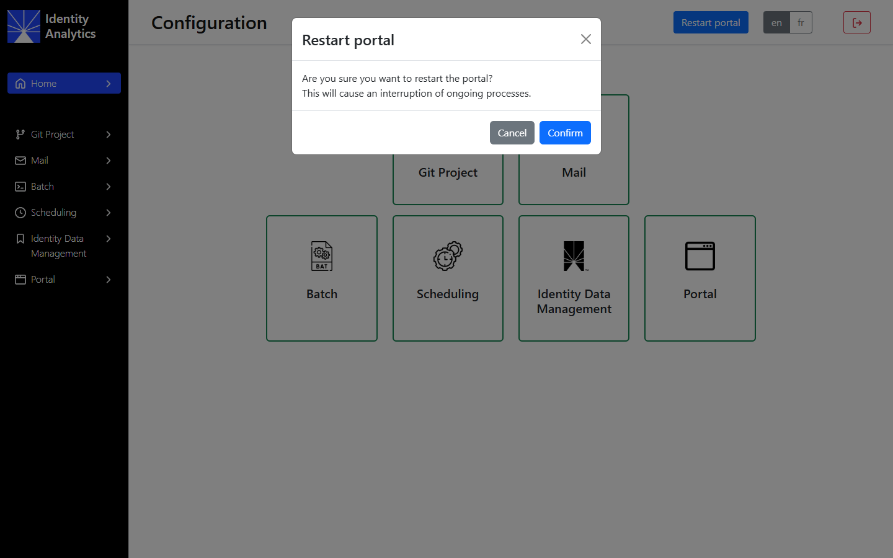

## Home

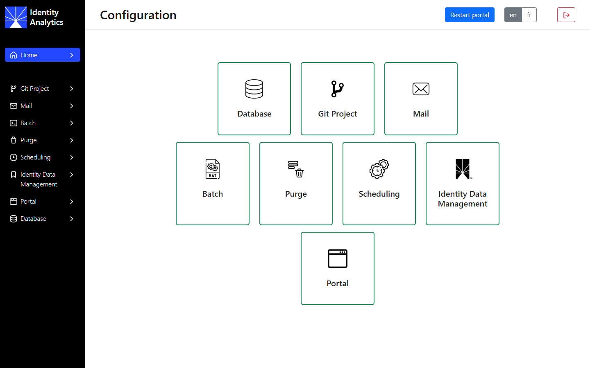

The home page provides a tile for each configuration page: Database, Git Project, Mail, Batch, Purge, Scheduling, Identity Data Management, and Portal. A tile displays a warning if its page contains missing or invalid settings.

## Git Project

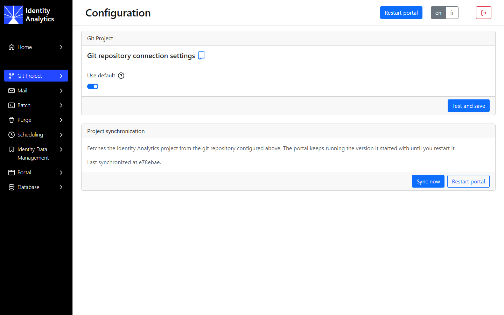

Use this page to select the project's Git repository.

- With Use default enabled, the instance uses the repository, branch, and credentials specified in the Helm values (`git.default.*`). This is the usual configuration.
- With Use default disabled, you can specify another repository. This selection is preserved across upgrades.

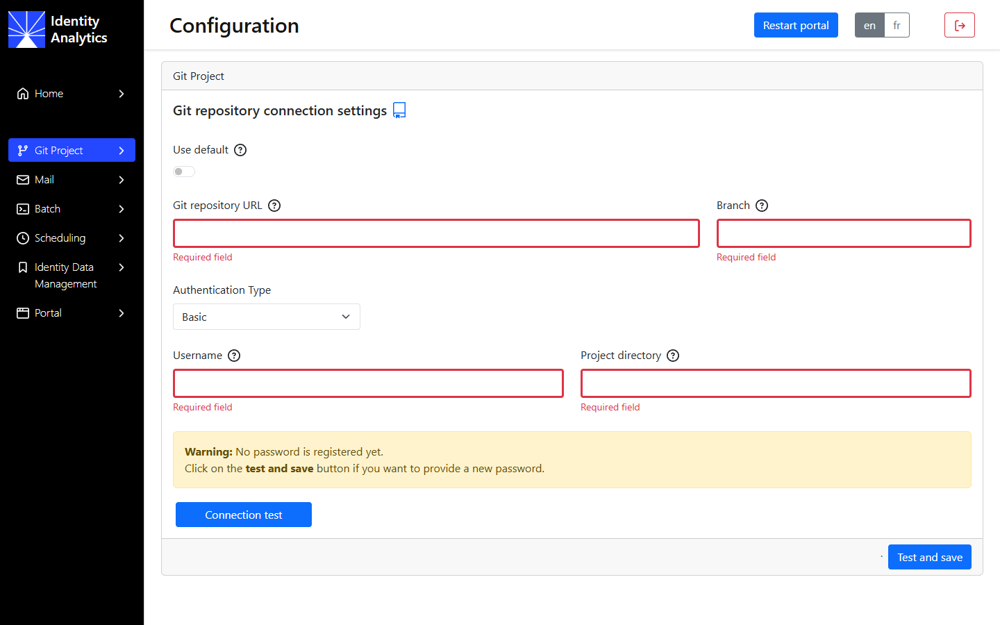

When specifying another repository, configure the following settings:

- Git repository URL and Branch: the repository and branch that contain the project.
- Authentication Type: Basic authentication, using a username and password or access token, or GitHub App authentication.
- Username: the account used to read the repository. You are prompted for the password when you select Test and save.
- Project directory: the repository folder that contains the project. The default is `brainwave`.

Connection test checks access to the specified branch using these settings. Test and save performs the same test and saves the settings only if the test succeeds.

Project synchronization fetches the project from the repository on a schedule. Select Sync now to fetch it immediately. Last synchronized at identifies the commit fetched during the most recent synchronization.

The portal continues to use the project version loaded at startup. Select Restart portal to load the newly synchronized version.

See [Project repository](../02-prerequisites.md#project-repository) for available repositories and credentials.

## Mail

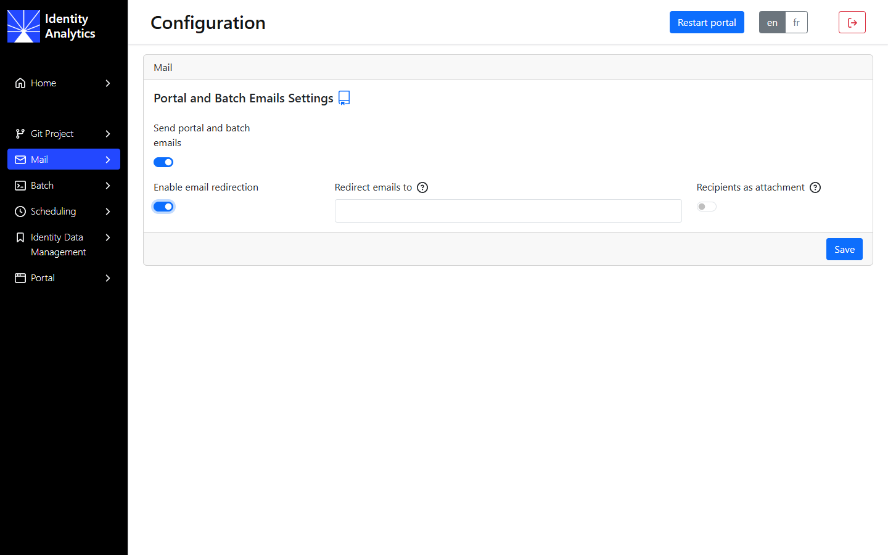

Use this page to control emails sent by the portal and batch. The SMTP server is configured through the `smtp.*` Helm values.

- Send portal and batch emails: enables or disables these emails.
- Enable email redirection and Redirect emails to: redirect all emails to a single address instead of their intended recipients, for example on an acceptance instance.
- Recipients as attachment: attaches the list of intended recipients to each email when enabled.

## Batch

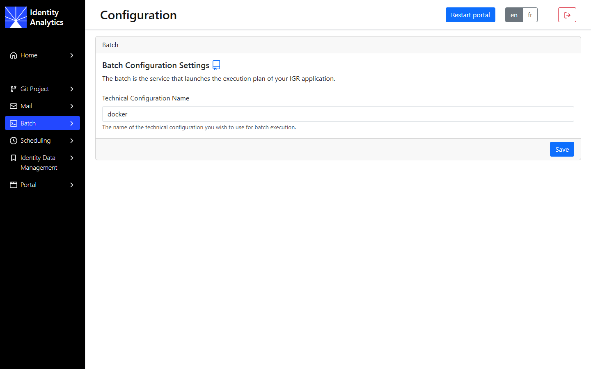

Technical Configuration Name specifies the project technical configuration used to run execution plans. The default is `docker`.

## Purge

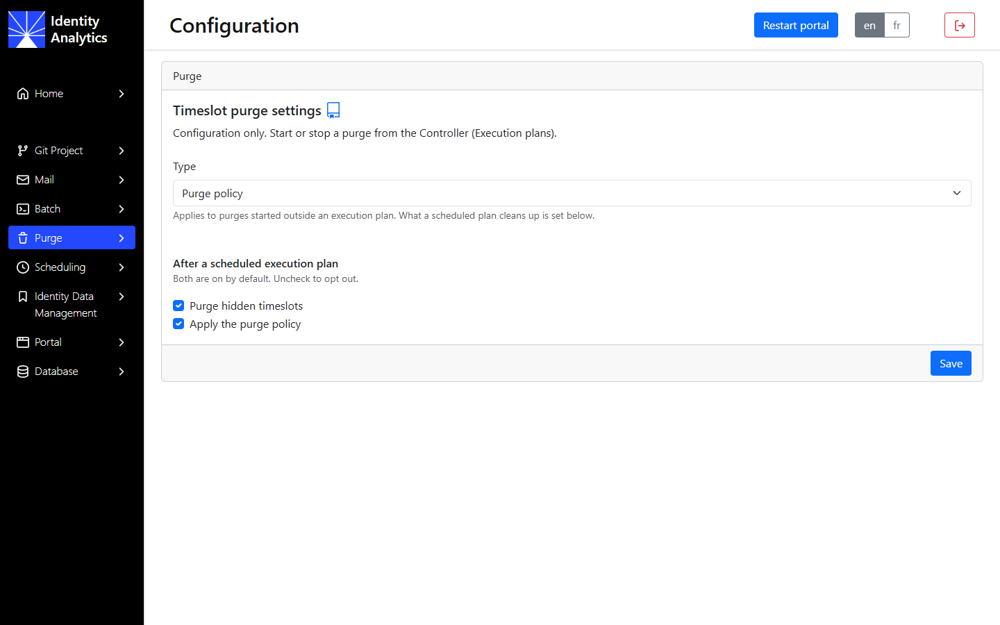

Use this page to define what a purge deletes. Saving these settings does not start a purge. To start one, go to Execution plans > Submit a purge in the controller, or configure a schedule on the Scheduling page.

- Type controls purges started outside an execution plan:
  - Purge policy applies the project's retention policy.
  - Legacy arguments retains timeslots by count or age, or deletes timeslots in specified states.
- After a scheduled execution plan controls automatic purging after scheduled plans. Purge hidden timeslots and Apply the purge policy are both enabled by default. Clear both options to prevent scheduled plans from purging timeslots.

Manually started execution plans never purge timeslots.

## Scheduling

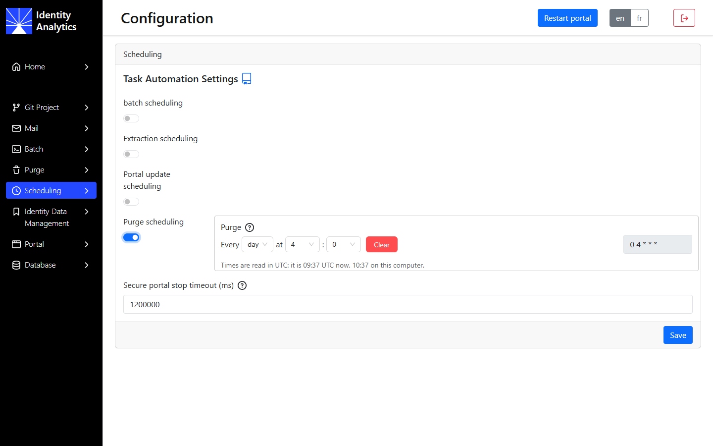

Use each switch to enable a recurring task, then set its frequency using Every (day or hour) and at. The corresponding cron expression appears on the right. Select Clear to remove a schedule.

- batch scheduling: starts an execution plan.
- Extraction scheduling: runs the connectors configured in the portal.
- Portal update scheduling: restarts the portal to load the latest synchronized project version. See [Project changes](../11-operations/05-project-changes.md).
- Purge scheduling: starts a purge using the settings on the Purge page.
- Secure portal stop timeout (ms): specifies how long ongoing tasks can continue during portal shutdown before the portal is forced to stop.

Schedules use UTC. The page displays both the current UTC time and your computer's local time.

> [!note]
> Stagger schedules to avoid overlapping tasks. Execution plans can take a long time, and the portal should not restart while a plan is running.

## Identity Data Management

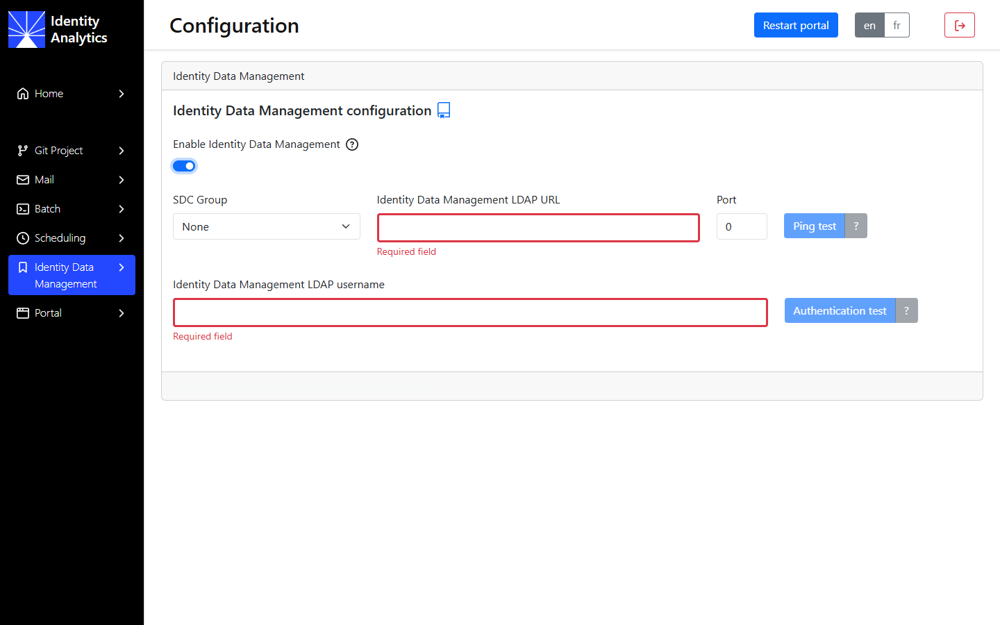

Use this page to connect the instance to RadiantOne Identity Data Management. See [Identity Data Management integration](../07-integrations/iddm.md).

- Enable Identity Data Management: enables the connection.
- SDC Group: specifies the RadiantOne Secure Data Connector group, if you use one.
- Identity Data Management LDAP URL and Port: specify the Identity Data Management LDAP endpoint. Select Ping test to check whether the endpoint is reachable.
- Identity Data Management LDAP username: specifies the account used to connect. Select Authentication test to check the connection using this account and its password.

Settings are saved only after the corresponding test succeeds.

## Portal

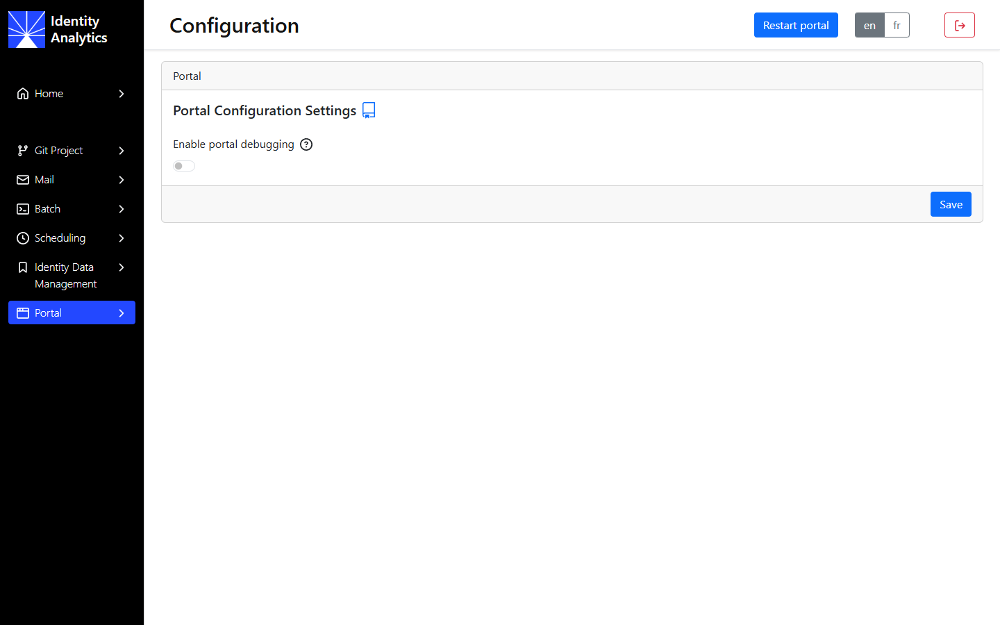

Enable portal debugging displays debug context on portal pages. Do not enable this option in production.

## Database

The database pages are available only when the instance uses the built-in database. With an external database, these pages are hidden, and your database administrator is responsible for maintenance.

### Health Check

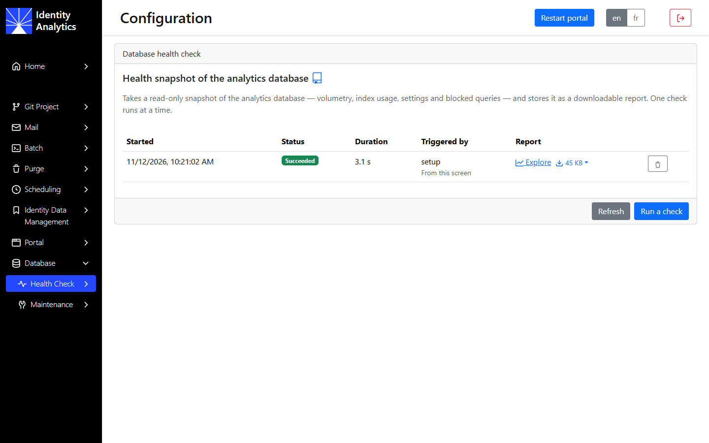

Select Run a check to capture a read-only snapshot of the analytics database, including data volumes, index usage, settings, and blocked queries. Only one check can run at a time.

Select Explore to open the report, or use the download icon to save it.

### Maintenance

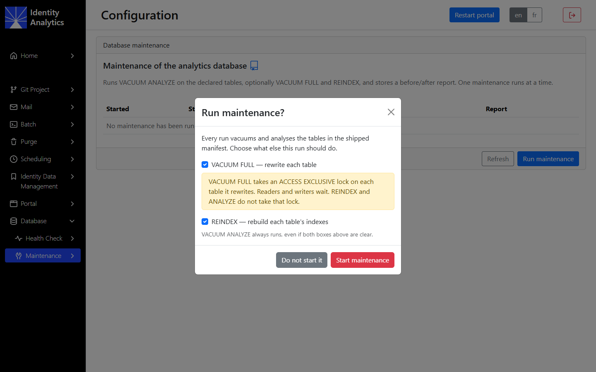

Select Run maintenance to run `VACUUM ANALYZE` on the project's tables. The `VACUUM FULL` and `REINDEX` options are also selected by default. A report records the database state before and after maintenance.

`VACUUM FULL` locks each table while rewriting it. Clear this option unless no execution plan is running and portal activity is low.

> [!note] If these pages display "not available in this deployment" when the instance uses the built-in database, restart the operations manager: `kubectl rollout restart deployment/ops-manager -n <IDA_NAMESPACE>`
