# Azure Active Directory (Entra ID) extractor configuration

The Entra ID extractor (formerly Azure Active Directory) extracts the users, groups, group members and group owners of an Entra ID tenant, and adds the resulting files to the import files used by the Entra ID collectors of the project.

The extractor is part of the instance: nothing is installed on a server. When you declare an Entra ID data source in the portal, a connector is created in the controller and runs on a schedule in the `extractor` pod. This pod calls the Microsoft APIs over HTTPS: allow outbound access from the cluster to `login.microsoftonline.com` and `graph.microsoft.com` (port 443), through your proxy if you use one.

## Entra ID Configuration

To enable data extraction, an application must be registered in Entra ID. We recommend creating a dedicated application specifically for the Identity Analytics service.

Once you create an application in Entra ID, you will need to store:

* The application (client) Id
* The client secret
* The azure tenant Id

To create and register the application, follow the steps outlined below. For additional details, read the [Register app](https://learn.microsoft.com/en-us/entra/identity-platform/quickstart-register-app) documentaion.

### Application creation

1. Connect to your Azure Active Directory admin center and navigate to the "All services" page.
2. Click on "Azure Active Directory".
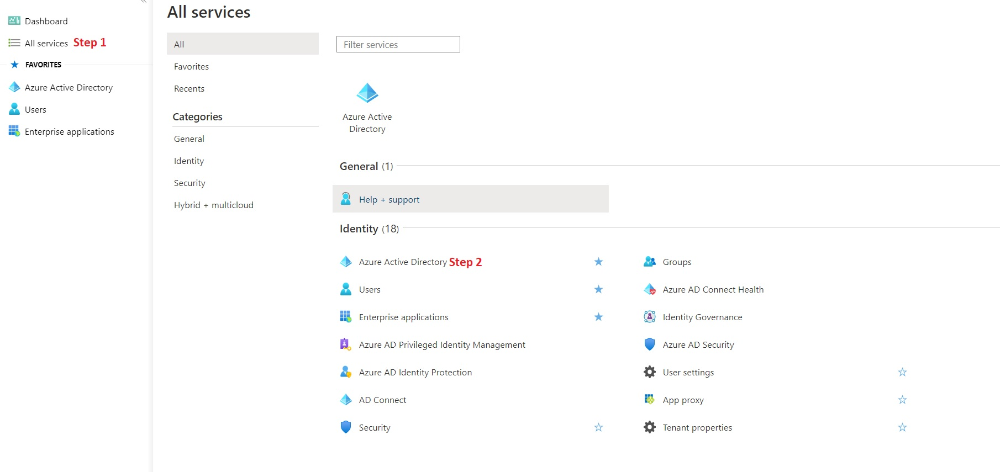  
3. Navigate to the "App registrations" tab. 
4. Click "New registration" to register a new application.  
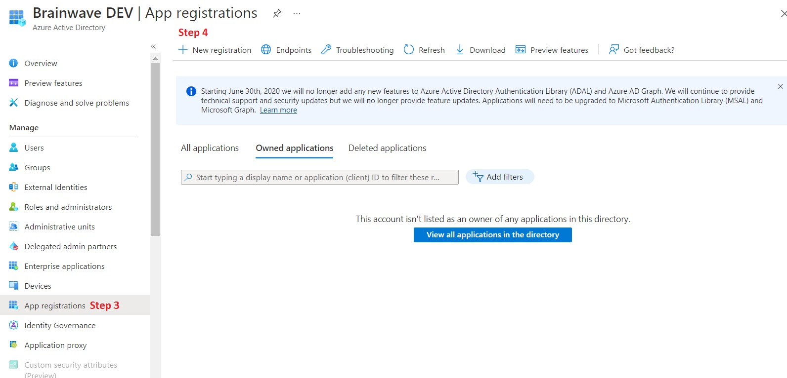  
5. Enter the desired name for your application, for example "AD Azure Data Extraction".
6. Select the type of accounts that can access the application. We recommend using the single tenant option: "Accounts in the organizational directory only".
7. In Redirect URI, select the "Public client (mobile & desktop)" option in the dedicated combo.
8. Next, click "Register".
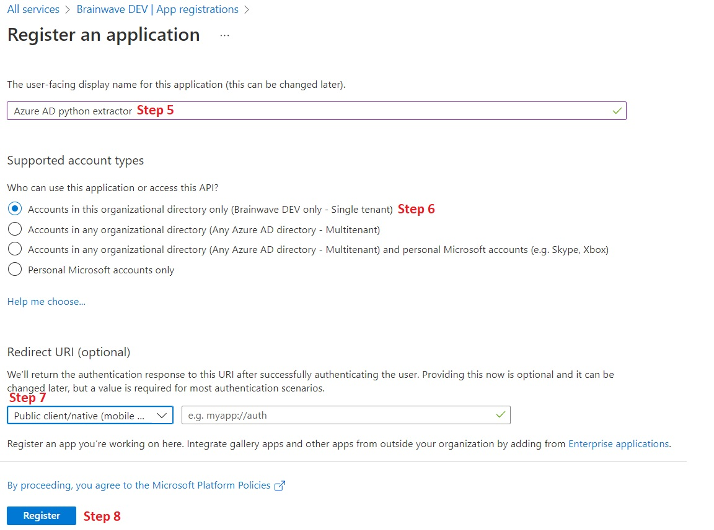  
10. Once the application is created, copy and store the "Application (client) ID". This parameter will be used in the Identity Analytics service to configure the extractor:  
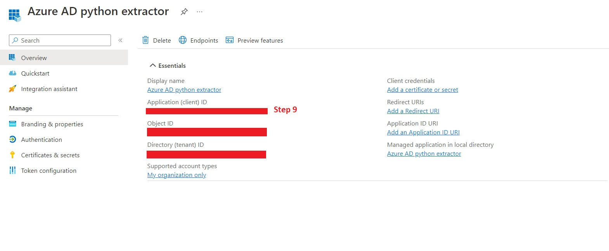  

#### Application permission configuration

10. Withtin the newly created app, navigate to the "API permissions" menu.
11. Click on "Add a permission".  
12. Select the "Microsoft Graph" API.
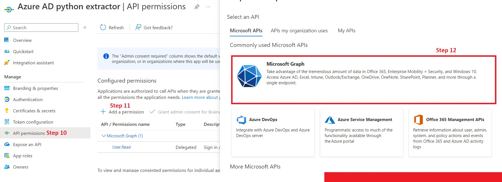  
13. Click on "Application permissions".
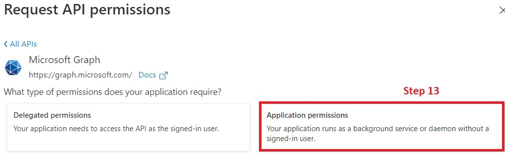
14. Search for "Directory.Read.All" and click on its checkbox. 
15. Search for "Member.Read.hidden" and click on its checkbox. 
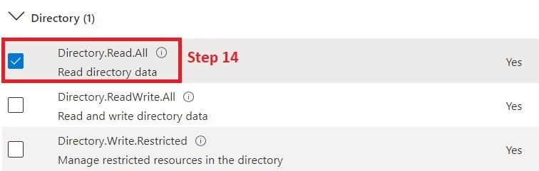  
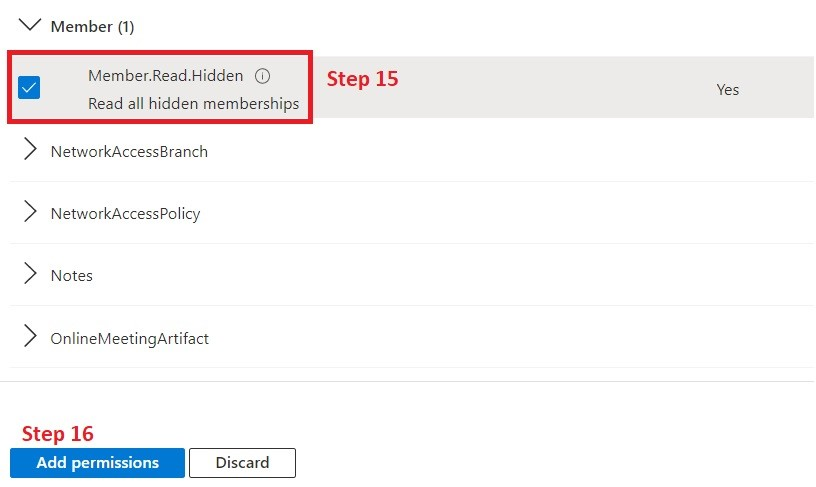  
16. Add the selected permissions.
17. Using an admin account grant consent for the requested permissions.
18. Confirm that you grant these permissions. 
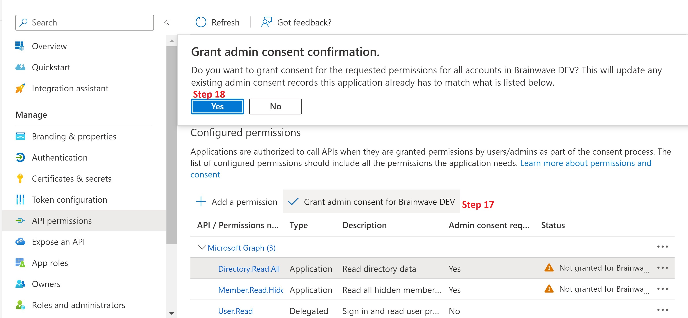  

Once you grant consent, you should see the following status:  
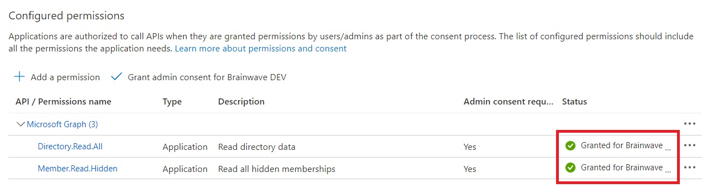  

#### Application Certificates & secrets

19. In the application page now Click on "Certificates & secrets".
20. Add a "New client secrets".
21. Provide a description for the client secret and select the desired expiration date.
22. Click on "Add".  
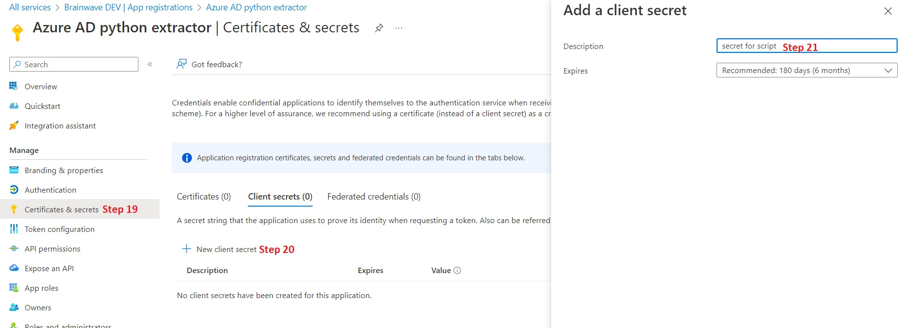  

> [!warning] Remember to immediately copy the value of the generated secret and store it in your password management application as it is only displayed once.  
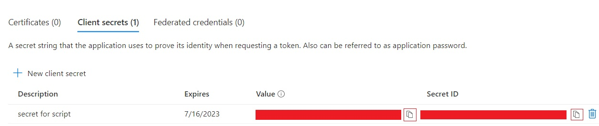  

## Portal configuration

### Configure the extractor

1. In the portal, open **Datasource Management**, **Configure**.
2. Click on Add.  
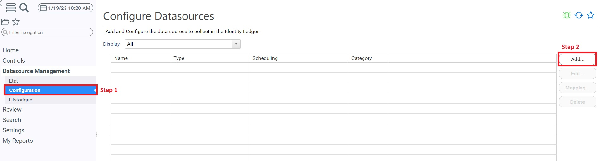  
3. Select Azure Active Directory.
4. Click on Next.  
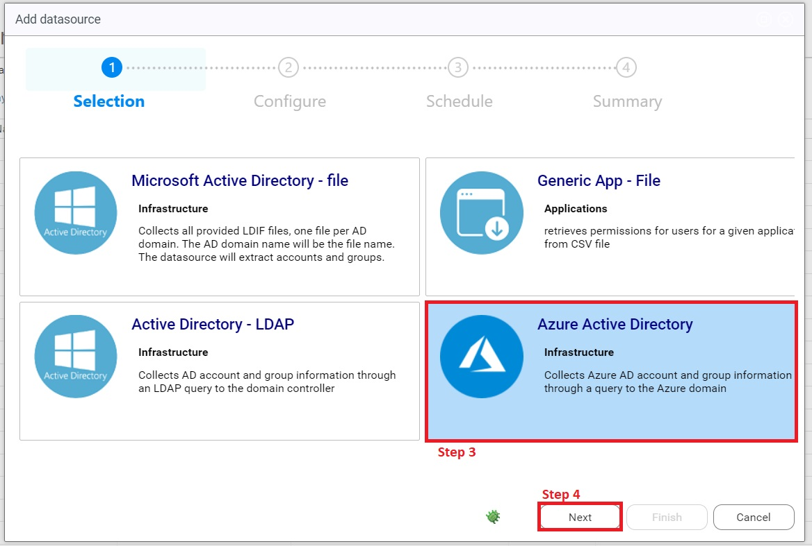  
5. Fill the field with the right informations and click on next:
  - The datasource name should not contain any space.
  - The application id and tenant id correspond to the one we created earlier.
  - The client secret is the one you created earlier in the azure application. If you did not kept it, you can just recreate one.  
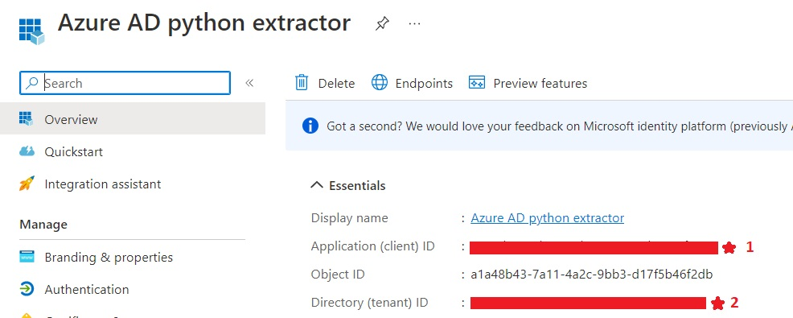  
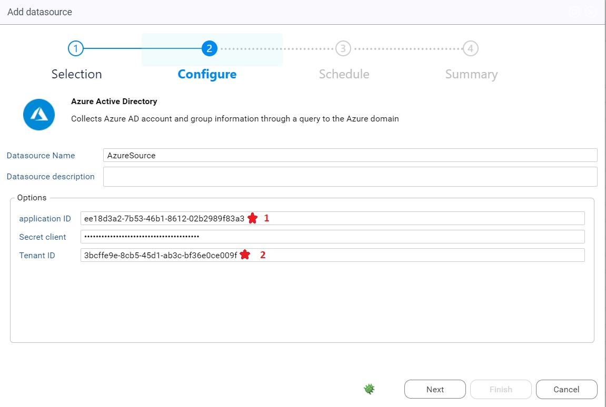  
6. Select the frequency you want for your azure data to be collected.  
7. Click Next. 
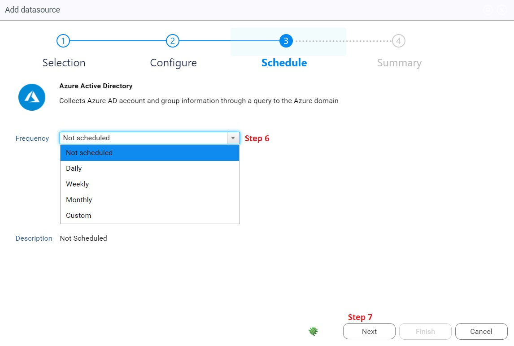  
8. Click Finish.  
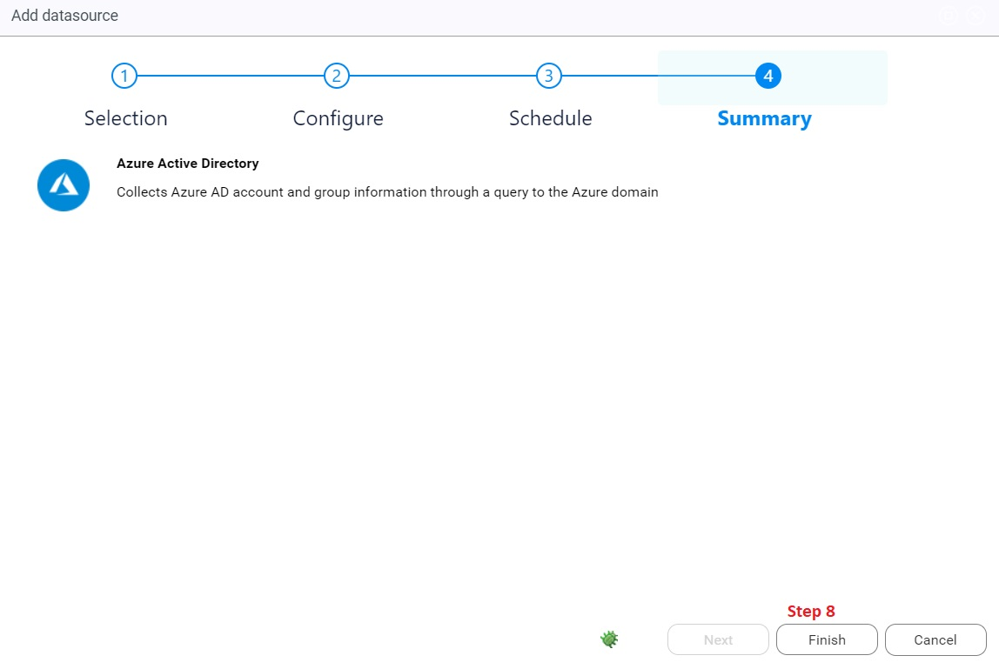  
9. Additionally, if you want to review or modify your extractor parameters, you can edit it: 
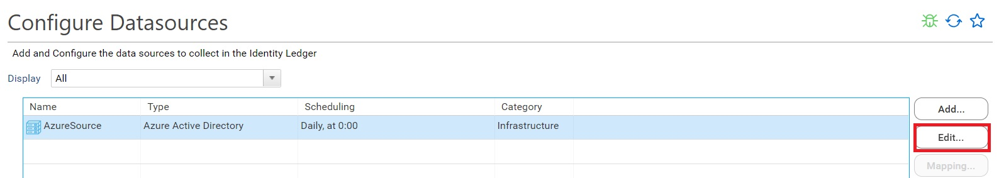

### Extractor validation

Using the controller you can test the configuration of your extractor by performing a test extraction.  

Refer to the controller documentation [Controller](../09-components/controller.md) for more information.  

The execution of the Azure Active Directory script generates 4 `csv` files. These files are:  

* `domainName_users.csv`
* `domainName_groups.csv`
* `domainName_groups_members.csv`
* `domainName_groups_owners.csv`
