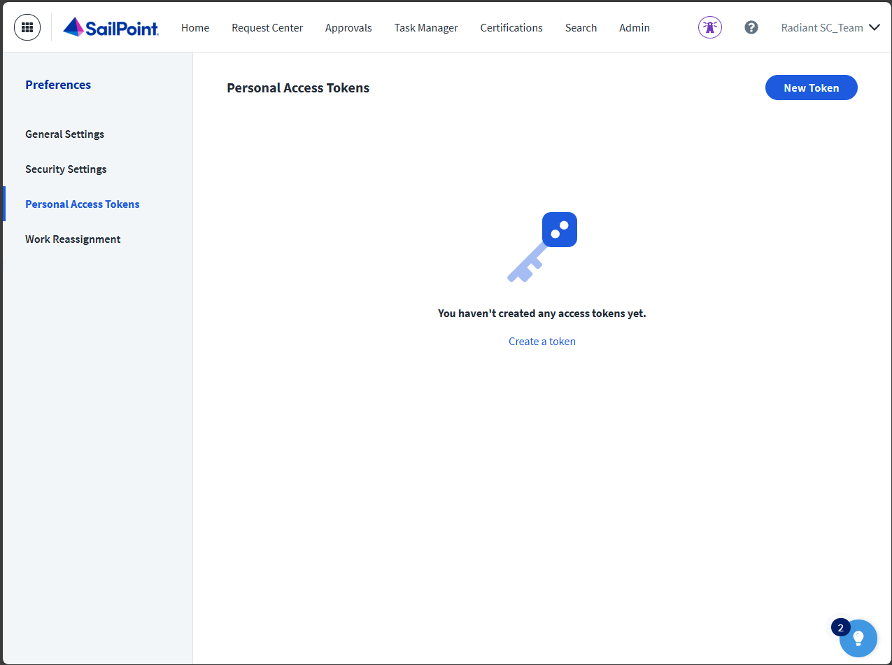
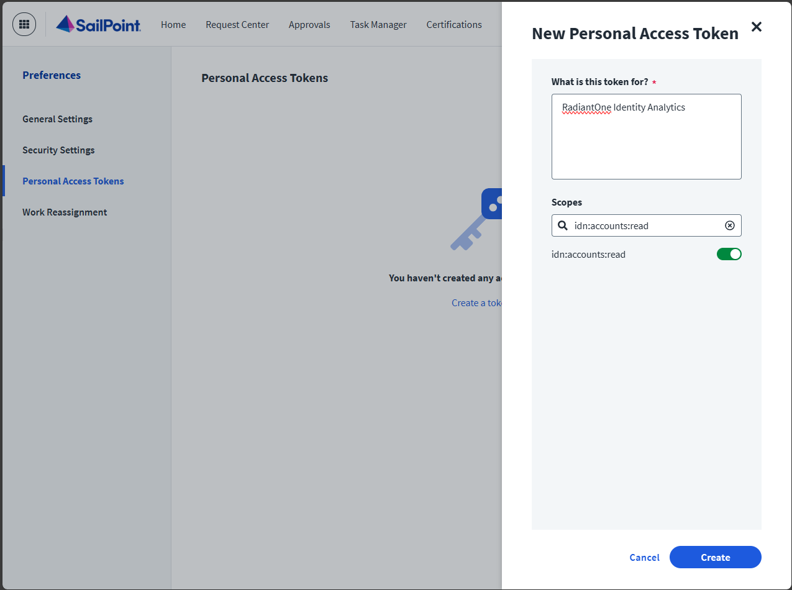
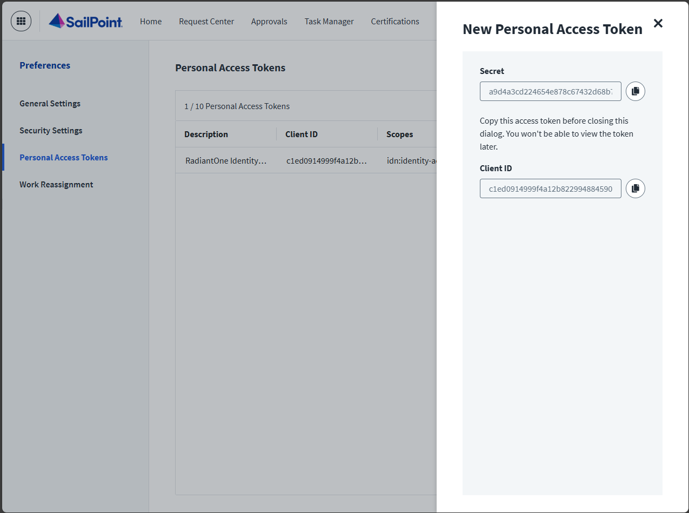
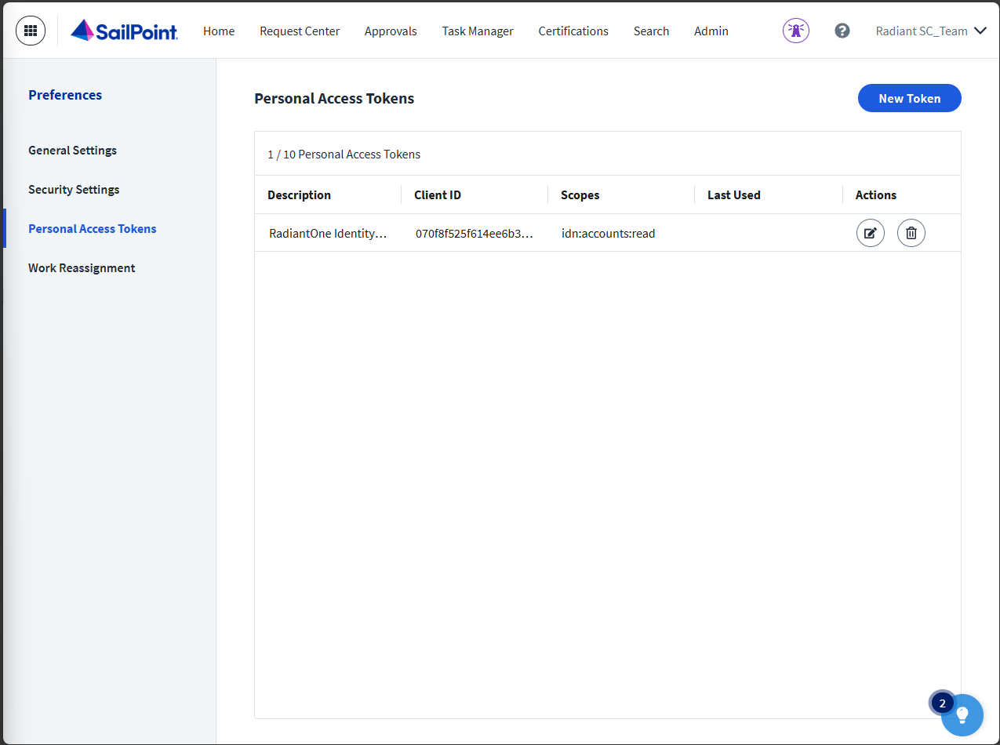
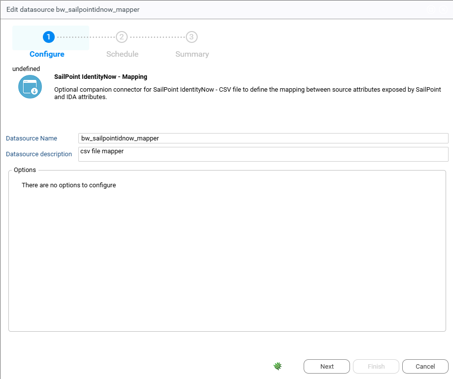

# SailPoint IdentityNow

## Introduction

This document provides instructions for integrating identity data from SailPoint IdentityNow into Radiant Logic Identity Analytics. This extractor leverages SailPoint IdentityNow v3 API.

## SailPoint IdentityNow Configuration  

- Log into SailPoint IdentityNow: Use an account with administrative privileges to access the instance.
- Navigate to your account preferences (drop down menu under your name) and Select "Personal Access Tokens" in the left menu.



- Click on "New token" to create a new access token

> [!note] A personal access token belongs to the account that creates it and stops working when this account is disabled. Create it with an account dedicated to the integration rather than with a personal administrator account.

- Add a description such as "RadiantOne Identity Analytics"
- Select the following Oauth2 scopes:
  - `sp:scopes:default`
  - `idn:accounts:read`
  - `idn:role-unchecked:read`
  - `idn:access-profile:read`
  - `idn:sources:read`
  - `idn:entitlement:read`



- Save the Secret and the Client ID in a safe place and close the right panel





## Identity Analytics Portal Configuration

- SailPoint IdentityNow is one of the data source connectors. In the Identity Analytics portal, open **Datasource Management**, **Configure**.
- Create a new datasource: Select "SailPoint IdentityNow" in the connector list and fulfill the following fields:  
  - tenant (it is located here in the URL https://**MYTENANT**.identitynow.com/)
  - clientid
  - secret

If you have an alternate SailPoint url such as https://MYTENANT.identitynow-demo.com/ you can set it by using the optional parameter "overriden url" with the value **identitynow-demo.com**

This extractor will load the following information in the ledger:  

- "SailPoint IdentityNow" Repository and Application
- SailPoint public Identities as "SailPoint IdentityNow" accounts
- SailPoint roles as "SailPoint IdentityNow" permissions with role type and groups (along with membership to "SailPoint IdentityNow" accounts)
- SailPoint accounts as new Repository/Accounts (SourceName is used as a repository)
- SailPoint access profiles and Entitlements as source application permissions with role type (along with Roles \> Access Profiles \> Entitlements and Roles \> Entitlements links)

## IdentityNow – Identity Analytics mapping configuration

Optionally you can configure the companion "SailPoint IdentityNow – Mapping" datasource.



This allows you to load additional account data, specifically data under the "attributes" field in IdentityNow. This data generally is composed of source attributes exposed by the source, without any additional meaning necessarily attached to it.

To fit this information, provide a mapping file that associates source attributes with Identity Analytics account attributes. The file is named `idnow_mapping.csv`, uses commas as separators and UTF-8 encoding, and starts with a header line. The columns are read by position, whatever their names in the header:

1. `source_id`: the SailPoint IdentityNow internal unique identifier of the source the attribute comes from;
2. `source_name`: the name of this source;
3. `source_attribute`: the name of the source attribute, exactly as returned by the v3 API;
4. `ida_attribute`: the code of the Identity Analytics attribute to map it to (see the list at the end of this page).

Once the data source is configured and the mapping file contains at least one line, activate the collection of the source attributes: set the configuration variable `bw_sailpointidnow_extendschema` to `true` in the technical configuration of the project used by the instance (`docker.configuration`, in iGRC Studio), then push the project. See [Project changes](../11-operations/05-project-changes.md).

Note that any mapped source attribute will take precedence over the SailPoint IdentityNow default schema attribute, for example if "id" is mapped to clogin it will take over the default "name" attribute.

## Identity Analytics attributes

Here is a list of mappable Identity Analytics account attributes:

```txt
"cbadpasswordcount";"ccreatedate";"ccreateday";"ccustom1";"ccustom10";"ccustom11";"ccustom12";"ccustom13";"ccustom14";"ccustom15";"ccustom16";"ccustom17";"ccustom18";"ccustom19";"ccustom2";"ccustom20";"ccustom21";"ccustom22";"ccustom23";"ccustom24";"ccustom25";"ccustom26";"ccustom27";"ccustom28";"ccustom29";"ccustom3";"ccustom30";"ccustom31";"ccustom32";"ccustom33";"ccustom34";"ccustom35";"ccustom36";"ccustom37";"ccustom38";"ccustom39";"ccustom4";"ccustom5";"ccustom6";"ccustom7";"ccustom8";"ccustom9";"cdisabled";"cdontexpirepassword";"cemployeenumber";"cexpiredate";"cexpireday";"cflatgivenname";"cflatlogin";"cflatsurname";"cflatusername";"cgivenname";"cguid";"cidentifier";"clastlogindate";"clastloginday";"clastmodificationdate";"clastmodificationday";"clastmodifiedby";"clocked";"clogin";"clogincount";"cmail";"cmanagerdata";"cnextpwdchangedate";"cnextpwdchangeday";"cnoownercode";"cnoownerreason";"cnotnormalaccount";"cpasswordcantchange";"cpasswordexpired";"cpasswordlastsetdate";"cpasswordlastsetday";"cpasswordnotrequired";"cprivilegedaccount";"cprofile";"cservice";"csid";"csmartcardrequired";"csurname";"cusername"
```

For more information please visit: https://developer.radiantlogic.com/ia/descartes/igrc-platform/collector/04-components/target/#account-target
