# Controller

The controller receives the source files of the instance (uploads from the portal, the PowerShell extractor or the connectors), keeps the files used by the next execution plan, and starts and follows the execution plans.

It is available at `https://<IDA_DNS><IDA_PATH>/controller`. Log in with an account that has the `technicaladmin` role, for example `setup`.

All the pages share the same layout:

- the menu on the left: **Home**, **Import files**, **Uploads**, **Connectors**, **Execution plans** and **Configuration**;
- in the header, the bell icon opens the [Events](#events) page (a red dot shows new events), and the power icon logs you out;
- the tables can be sorted by clicking a column header and filtered with the boxes above them.

Dates are displayed in the time zone of your browser, except the **File date** columns, displayed in UTC.

## Home

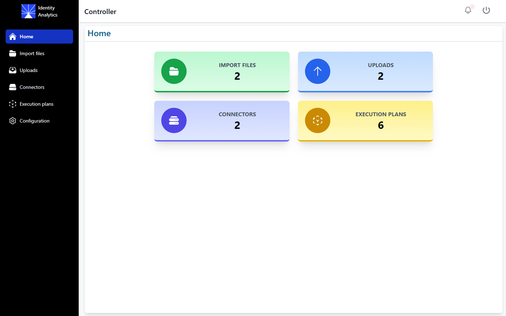

The home page shows four tiles, with the number of import files, uploads, connectors and execution plans. Click a tile to open the corresponding page. A banner tells you when an execution plan is submitted or running.

## Import files

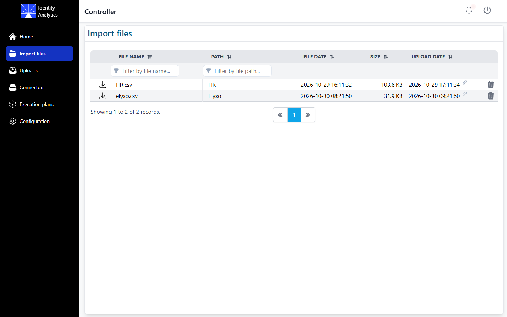

This page lists the files that the next execution plan will use, with their name, their path (the folder of the data source under the import files), their date, their size and the upload they come from.

- The download icon downloads the file.
- The trash icon deletes the file from the import files, after confirmation. If a later upload contains a file with the same name and path, it becomes part of the import files again.
- The link icon next to the upload date opens the details of the upload.

## Uploads

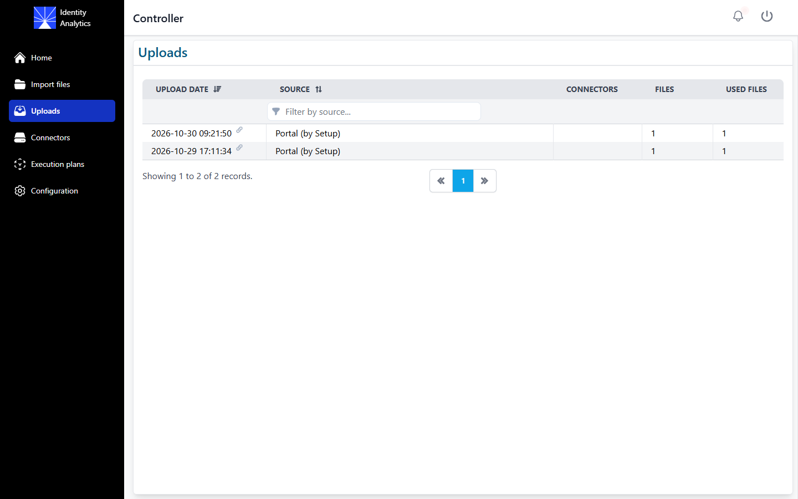

This page lists the uploads received by the instance, with their date, their source (for example `Portal (by Setup)`), the connectors they come from, the number of files they contained and the number of these files still present in the import files.

Click the date of an upload to open its details:

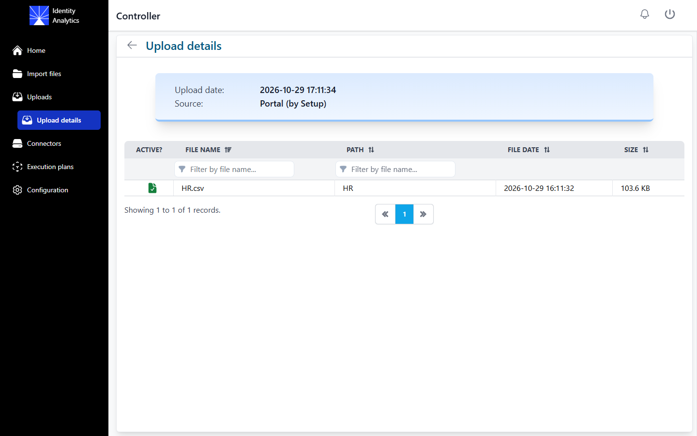

The **Active?** column shows whether each file of the upload is still in the import files, or has been replaced by a later upload or deleted.

## Connectors

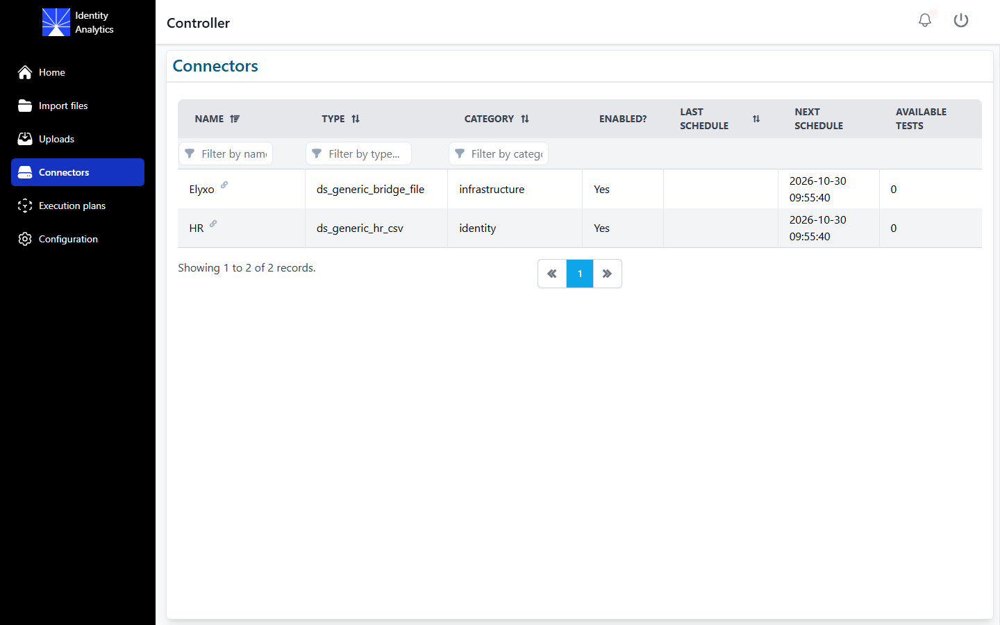

This page lists the connectors declared in the portal, with their type, their category, whether they are enabled, the dates of their last and next scheduled runs, and the number of test results available (**Available tests**, see below). The next run date can be in the past when the scheduling of the extractions is disabled in the configuration interface.

Click a connector to open its details:

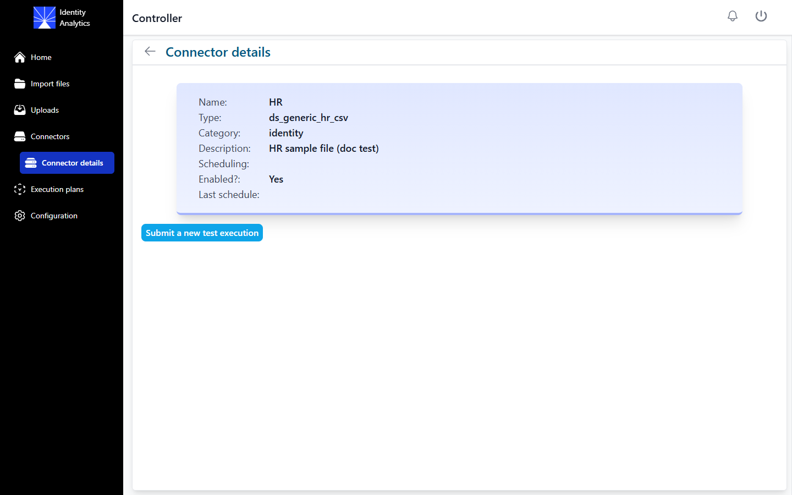

**Submit a new test execution** runs the connector once and keeps its result as a test, without adding it to the import files. In the table of test results, you can download a result, delete it, or transfer it to the import files so that the next execution plan uses it.

## Execution plans

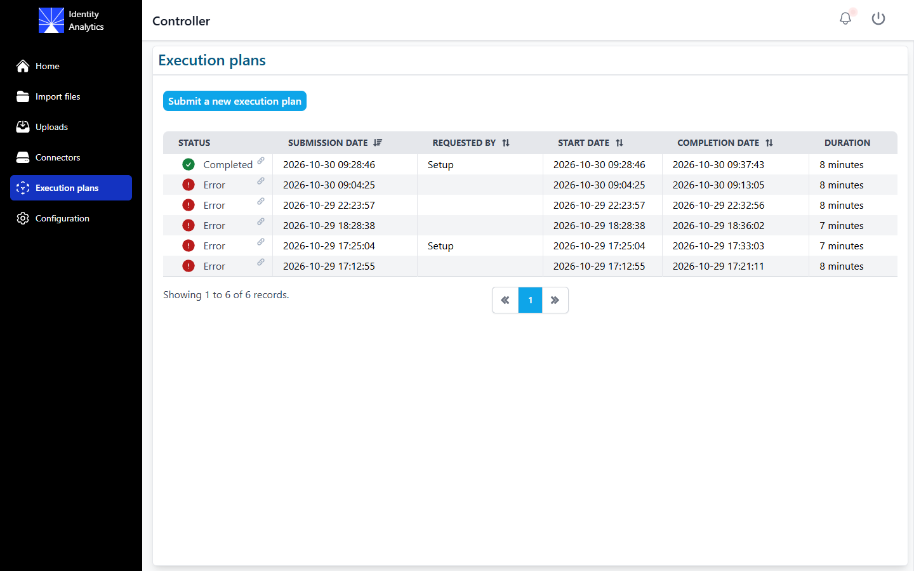

This page lists the execution plans, with their status, their submission, start and completion dates, their duration and the user who requested them.

- **Submit a new execution plan** starts an execution plan immediately with the current import files, without confirmation. The button is hidden while a plan is submitted or running. You can also start a plan from the portal (**Datasource Management**, **Launch an execution plan**).
- While a plan is running, the orange square button aborts it.
- The status of a plan is **Submitted** (the batch has not started yet), **Running**, **Completed**, **Error** or **Aborted**.

Click the link icon next to a finished plan to open its details:

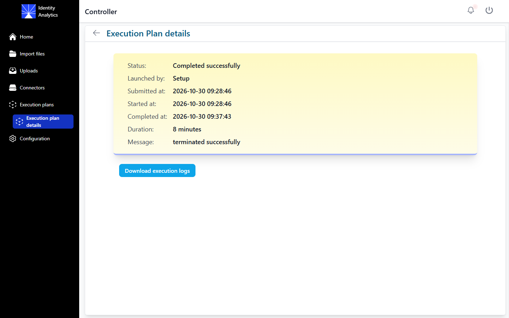

The details page shows the status, the user who launched the plan, its dates, its duration and the message of the batch. **Download execution logs** downloads a zip file with the summary of the plan (phases, steps, data files used and Git commit of the project) and the batch report.

By default, the new timeslot is validated automatically at the end of a successful plan.

## Events

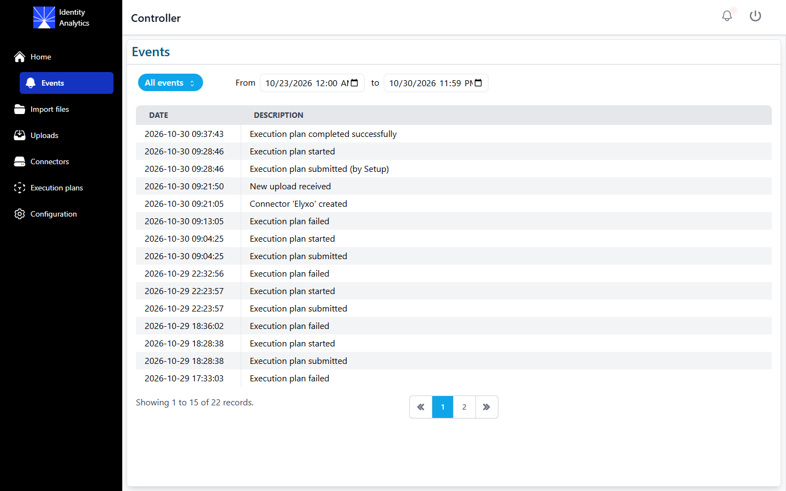

The bell icon of the header opens the list of the events of the controller: uploads received, connectors created, execution plans submitted, started, completed or failed. Filter them by type (upload, execution plan or connector events) and by date range: the last 7 days are displayed by default.

## Configuration

### Notifications

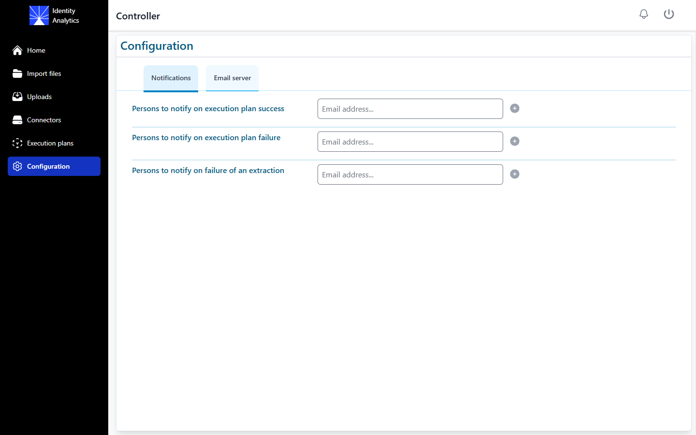

Enter the email addresses to notify when an execution plan succeeds, when it fails, and when an extraction fails. Type an address and click (+) to add it. The controller sends these emails only if SMTP is enabled.

### Email server

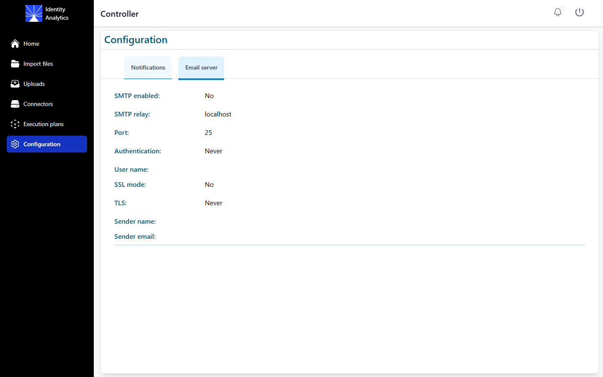

This tab displays the SMTP settings of the instance. It is read only: the SMTP settings come from the `smtp.*` values of the Helm chart. To change them, update your values file and run `helm upgrade`. See [Which setting wins](../06-configuration/01-config-ui.md#which-setting-wins).
