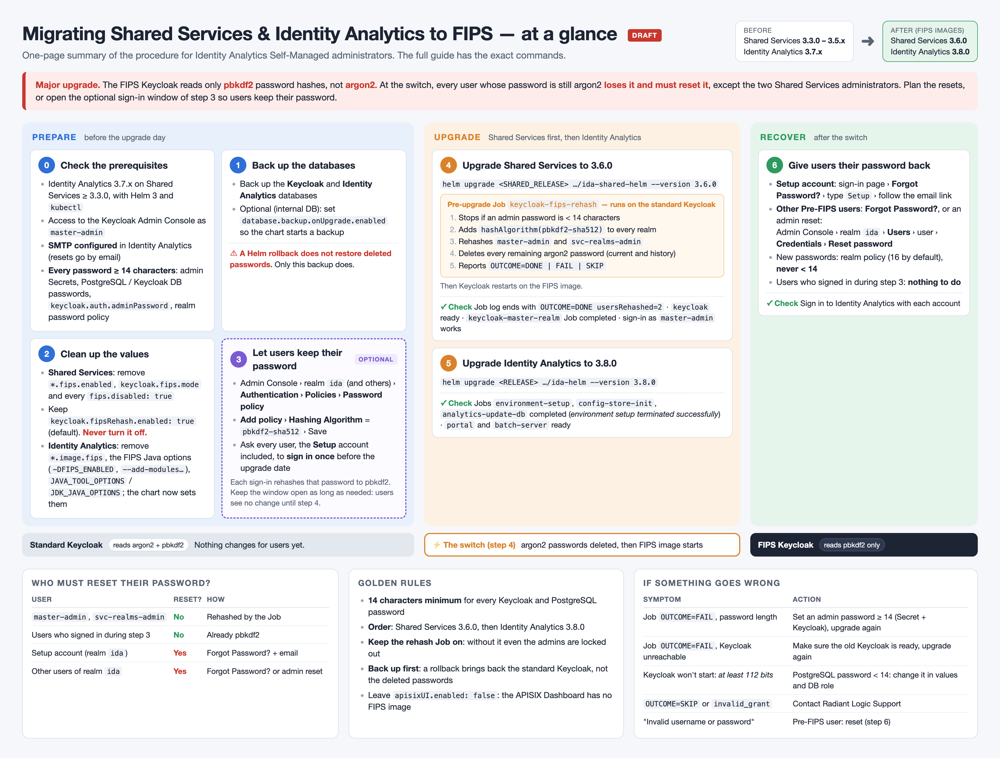

# Migrating Shared Services and Identity Analytics to FIPS

This guide is for administrators who manage Identity Analytics Self-Managed installation and upgrades. It describes how to upgrade a Self-Managed Identity Analytics installation from Identity Analytics 3.7.x on standard (non-FIPS) Shared Services 3.3.0–3.5.x to Identity Analytics 3.8.0 on Shared Services 3.6.0., which run FIPS images.

> [!warning] This is a major upgrade. Shared Services 3.6.0 and Identity Analytics 3.8.0 switch all applications to FIPS images: Keycloak, APISIX, etcd, PostgreSQL, the portal, the batch server, and data recovery. These images use only FIPS 140-3 validated cryptographic modules. After the switch, Keycloak can no longer read passwords stored by standard Keycloak. Users whose passwords are not converted before the upgrade must reset them. Review [Design](#design) and plan password resets before you begin. To let users retain their passwords, complete [step 3](#3-optional-let-users-keep-their-password). 

## Overview

### Versions

| Application | Chart | Before the upgrade | After the upgrade |
|---|---|---|---|
| Shared Services | `ida-shared-helm` | 3.3.0 to 3.5.x (standard Keycloak 26.5.3 or 26.7.4) | 3.6.0 (FIPS Keycloak 26.8.1) |
| Identity Analytics | `ida-helm` | 3.7.x | 3.8.0 |

Shared Services 3.3.0 is the oldest version this upgrade supports. Upgrade Shared Services first, then Identity
Analytics. The FIPS images are required from these versions on: there is no option to stay on the standard images.

### The Identity Analytics realm

The users of Identity Analytics are in one Keycloak realm, named after the Kubernetes namespace where Identity
Analytics is deployed. For example, Identity Analytics deployed in the namespace `ida-prod` uses the realm `ida-prod`. This guide uses Identity Analytics as the realm name. Replace it with your Identity Analytics realm name, <NAMESPACE>.

### At a glance



The summary shows the realm as `ida`: read it as the Identity Analytics realm, `<NAMESPACE>`.

## Design

### Why passwords stop working

The standard Keycloak stores every password hashed with **argon2**. The FIPS Keycloak can verify only **pbkdf2**
hashes. A password stored before the switch, however long, is refused after it.

Keycloak rehashes a password when its owner signs in, with the algorithm of the realm's **hash rule** (the
`hashAlgorithm(...)` clause of the realm's password policy). A user who signs in while the rule is
`hashAlgorithm(pbkdf2-sha512)` and the standard Keycloak still runs keeps their password after the switch.

### What the upgrade does

The Shared Services 3.6.0 upgrade runs a pre-upgrade Job, `keycloak-fips-rehash`, while the standard Keycloak is
still running. This job handles the following:

1. It stops the upgrade if the password of `master-admin` or `svc-realms-admin` is shorter than 14 characters.
2. It adds the hash rule `hashAlgorithm(pbkdf2-sha512)` to the password policy of every realm, and keeps every other
   rule (length, history, expiry…).
3. It signs in as `master-admin` and `svc-realms-admin`, the two Shared Services administrators, so their passwords
   are rehashed to pbkdf2.
4. It deletes every current and past password stored with argon2. Without that, the FIPS Keycloak could not reset
   them: the password history check fails on a hash it cannot read.
5. It lists, per realm, the users still on a hash the FIPS Keycloak cannot read, and ends with one line
   `CAUSE=… OUTCOME=DONE|FAIL|SKIP … credentialsPurged=<n>`. It never writes a password in its log.

Keycloak then restarts using the FIPS image. The two Shared Services administrators retain their passwords and can sign in as usual. Other users whose passwords remain in the standard Keycloak format (Pre-FIPS users) must reset their passwords. They can sign in only after the password reset. 

| User | How they get a password back |
|---|---|
| `master-admin`, `svc-realms-admin` | None. The Job rehashes their passwords automatically. |
| Setup account (Identity Analytics realm) | Click **Forgot Password?** on the sign-in page, then the link in the email. |
| Other users of the Identity Analytics realm | Click **Forgot Password?**, or ask an admin to reset it in the Keycloak Admin Console. |
| Users who signed in with the hash rule set, before the switch ([step 3](#3-optional-let-users-keep-their-password)) | None. Their passwords already use pbkdf2. |

The Job runs again on every later Shared Services upgrade. On a Keycloak already on FIPS it changes nothing and every
password keeps working.

The Identity Analytics 3.8.0 upgrade adds the same hash rule to the Identity Analytics realm if it is missing, and a
new installation creates the realm with it. It does not change the other rules of the policy, nor the stored passwords.

The Job runs again during subsequent Shared Services upgrades. If Keycloak already uses FIPS, it makes no changes, and existing passwords continue to work.

The Identity Analytics 3.8.0 upgrade also adds the hash rule to the Identity Analytics realm if it is missing. New installations create the realm with this rule. This operation does not modify other password policy rules or existing password hashes.

### Minimum password length

FIPS Keycloak rejects new passwords shorter than 14 characters, regardless of the realm's password policy. The Identity Analytics realm already requires at least 16 characters by default.

The same 14-character minimum applies to all passwords used to connect to PostgreSQL.

## Prerequisites

Before you begin, ensure that you have:

- Identity Analytics 3.7.x deployed with Helm on Shared Services 3.3.0–3.5.x.
- Helm 3 and `kubectl` access to the Shared Services namespace (`<SHARED_NAMESPACE>`) and Identity Analytics namespace (`<NAMESPACE>`). This guide uses `<SHARED_RELEASE>` and `<RELEASE>` for their Helm release names.
- Access to the Keycloak Admin Console at `https://<APP_ENDPOINT>/auth/admin/` as `master-admin`.
- An SMTP server configured in Identity Analytics so that the Setup account and other users can receive password reset emails.
- Passwords of at least 14 characters for all of the following:
  - `master-admin`, stored in `keycloak-master-admin`.
  - `svc-realms-admin`, stored in `keycloak-svc-admin-credentials`.
  - `database.postgres.password` and `database.keycloak.password`, or `database.external.password` for an external database, including credentials supplied through `existingSecret`.
  - `keycloak.auth.adminPassword`.
- A password policy requiring at least 14 characters in every realm. A lower minimum can allow users to choose passwords that FIPS Keycloak rejects.
- A maintenance window of approximately 30 minutes. Users cannot sign in while Keycloak restarts, and no execution plans should run during the upgrade.

Change any passwords shorter than 14 characters before upgrading. Update each password in its values file or Secret and in the corresponding system: Keycloak for administrator accounts, or the database role for PostgreSQL accounts.

## Procedure


### 1. Back up the databases

The upgrade deletes passwords that FIPS Keycloak cannot read. A Helm rollback restores the previous charts and images, but it does not recover deleted passwords. Recovering those passwords requires a database backup.

1. Back up the Keycloak and Identity Analytics databases using your usual backup procedure.

2. Optionally, if you use the internal database, configure the Shared Services chart to start a backup before the migration Job runs:

    ```
    database:
      backup:
        enabled: true
        onUpgrade:
          enabled: true
    ```

    The chart starts the backup but does not wait for it to finish.

### 2. Prepare the values

1. Remove the following deprecated settings from the Shared Services values:

    - `keycloak.fips.enabled`
    - `bwapisix.fips.enabled`
    - `keycloak.fips.mode`

    Also remove any `fips.disabled: true` settings under `keycloak`, `bwapisix`, `etcd`, `tools.image`, or `database.postgres.image`. All components must use their FIPS images.

2. Keep `keycloak.fipsRehash.enabled` at its default value, `true`. Disabling it skips the migration Job, leaving passwords—including administrator passwords—incompatible with FIPS Keycloak.

3. Remove obsolete FIPS settings from the Identity Analytics values. Starting with 3.8.0, the chart selects the FIPS images and supplies the required Java options. Manually configured FIPS settings from 3.7.x can disable FIPS or override the chart defaults.

    | Setting to find | Location | Required change |
    | :-------------- | :------- | :-------------- |
    | `fips:` | `batch.image`, `portal.image`, `dataRecovery.image`, `tools.image` | Remove the block. The chart uses FIPS images by default; `fips.disabled: true` selects a standard image. |
    | `--add-modules=org.bouncycastle.fips.pkix` and `-DFIPS_ENABLED=true` | `portal.javaOptions`, `portal.javaEclipseOptions`, `workflow.javaOptions`, `workflow.javaEclipseOptions` | Remove these flags because the chart now adds them. Preserve any unrelated options. |
    | `JAVA_TOOL_OPTIONS` or `JDK_JAVA_OPTIONS` | Component `env` maps, such as `batch.env`, `portal.env`, or `workflow.env` | Remove these variables. They override the FIPS image's Java options, so the chart drops them and issues a warning. Move any unrelated flags to the component's `javaOptions`. |
    | `-Dorg.bouncycastle.rsa.allow_multi_use` | Any Java option | Remove this flag; it is no longer required. |

    For example, replace this manually configured portal setting from 3.7.x:

    ```
    portal:
      javaOptions: "-Dmy.option=value --add-modules=org.bouncycastle.fips.pkix -DFIPS_ENABLED=true"
    ```

    With:

    ```
    portal:
      javaOptions: "-Dmy.option=value"
    ```

    If your values contain none of these settings, no changes are required.

4. Merge the 3.8 reference project into your project and set `git.default.branch` to `release/3.8`.

### 3. Optional: let users keep their password

Complete this step to give users an opportunity to retain their existing passwords. Otherwise, all users except the two Shared Services administrators must reset their passwords after the upgrade.

Before upgrading Shared Services, configure standard Keycloak to use the FIPS-compatible hash algorithm. Each subsequent successful sign-in rehashes the user's password to `pbkdf2-sha512` without changing the password itself.

1. Sign in to the Keycloak Admin Console as `master-admin`.

2. For each realm whose users should retain their passwords, including the Identity Analytics realm (`<NAMESPACE>`):

    1. Select the realm.
    2. Go to Authentication > Policies > Password policy.
    3. Click Add policy and select Hashing Algorithm.
    4. Enter `pbkdf2-sha512` and click Save.

    The new hashing rule is added without changing the other policy rules. Existing password hashes remain unchanged until users sign in or change their passwords.

3. Ask users, including the Setup account user, to sign in to Identity Analytics at least once before the upgrade. Each successful sign-in converts the user's password hash to `pbkdf2-sha512`. Passwords changed during this period also use the new algorithm.

4. Optionally, if you use the internal database, run the following query to identify users whose passwords still use `argon2`. The query reads the algorithm name, not the password data.

    ```
    kubectl --namespace <SHARED_NAMESPACE> exec -i keycloak-db-1 -c postgres -- \
      psql -U postgres -d keycloak_db -c "select r.name realm, u.username, c.credential_data::json->>'algorithm' algorithm
        from keycloak.credential c
        join keycloak.user_entity u on u.id = c.user_id
        join keycloak.realm r on r.id = u.realm_id
        where c.type = 'password' order by 1, 2"
    ```

    Users listed with `argon2` have not had their password hashes converted and will need to reset their passwords after the upgrade.

Allow as much time as needed for users to sign in. Standard Keycloak supports both `argon2` and `pbkdf2`, so users can continue signing in normally until the Shared Services upgrade.

### 4. Upgrade Shared Services to 3.6.0

1. Run the upgrade:

    ```
    helm upgrade <SHARED_RELEASE> oci://docker.io/radiantone/ida-shared-helm \
      --version 3.6.0 --namespace <SHARED_NAMESPACE> \
      --values <shared-values.yaml> --wait --timeout 20m
    ```

    The `keycloak-fips-rehash` Job runs first and can take several minutes. Keycloak then restarts using the FIPS image.

2. Review the `keycloak-fips-rehash` Job logs. A successful migration includes:

    - `passwordPolicy updated to include pbkdf2-sha512` for each realm, or `already uses` if the rule was configured in [step 3](#3-optional-let-users-keep-their-password).
    - `argon2 -> pbkdf2-sha512` for `master-admin` and `svc-realms-admin`.
    - A `purged password algorithm=argon2` entry for each Pre-FIPS user.
    - `purged password-history` entries, including for users who retain their passwords. These entries are expected.
    - A final summary such as `CAUSE=none OUTCOME=DONE usersRehashed=2 … credentialsPurged=<n>`.

    If the summary shows `OUTCOME=FAIL`, the upgrade has stopped without switching to FIPS. See [Troubleshooting](#troubleshooting).

3. Verify that the `keycloak` service is running and ready, and that the `keycloak-master-realm` Job has completed.

4. Sign in to the Keycloak Admin Console as `master-admin` using the existing password.

### 5. Upgrade Identity Analytics to 3.8.0

1. Run the upgrade:

    ```
    helm upgrade <RELEASE> oci://docker.io/radiantone/ida-helm \
      --version 3.8.0 --namespace <NAMESPACE> \
      --set global.license="$(base64 -w0 <PATH_TO_LICENSE_FILE>)" \
      --values <ida-values.yaml> --timeout 30m
    ```

    The pre-upgrade Job switches the database to its FIPS image and can take several minutes. If the command times out, run it again.

2. Verify that the `environment-setup`, `config-store-init`, and `analytics-update-db` Jobs have completed. The `environment-setup` logs should end with `environment setup terminated successfully`.

3. Verify that the `portal` and `batch-server` services are running and ready.

4. If you use the internal database, upgrade the CloudNativePG operator to chart 0.29.1 (operator 1.30), as described in [step 2 of the installation procedure](../../03-installation.md#2-install-the-cloudnativepg-operator). The database pods restart once.

### 6. Restore user access

1. For the Setup account, select Forgot Password? on the Identity Analytics sign-in page and enter `Setup`. Open the password reset link sent by email and set a password. The previous password can be reused because the upgrade deleted the old password history.

2. For other Pre-FIPS users, either ask them to use Forgot Password? or reset their passwords in the Keycloak Admin Console:

    1. Select the Identity Analytics realm, `<NAMESPACE>`.
    2. Go to Users and select the user.
    3. Open the Credentials tab and click Reset password.
    4. Enter a password that meets the realm's policy and save it. The default minimum is 16 characters, and FIPS requires at least 14.

    Keep the realm's password history rule enabled. Password resets work with this rule in place.

3. Verify that users can sign in to Identity Analytics. Users whose passwords were converted in [step 3](#3-optional-let-users-keep-their-password) can continue using their existing passwords without a reset.

## Roll back the upgrade

A Helm rollback of Shared Services restores standard Keycloak, which supports both `argon2` and `pbkdf2`. The two Shared Services administrators and users who have already reset their passwords can still sign in.

A rollback does not recover passwords deleted by the migration Job. To recover them, restore the database backup created in [step 1](#1-back-up-the-databases).

## Known limitations

- The APISIX Dashboard has no FIPS image. Leave `apisixUI.enabled: false` (default) for an installation with no
  non-FIPS workload.
- A realm created after the Shared Services upgrade gets the hash rule only if the application that creates it writes
  it. Identity Analytics 3.8.0 does so for the Identity Analytics realm.

## Troubleshooting

| Symptom | Likely cause | Action |
|---|---|---|
| Shared Services upgrade stops, Job log `OUTCOME=FAIL` with a password length cause | `master-admin` or `svc-realms-admin` password shorter than 14 characters | Set a 14-character or longer password in the Secret and in Keycloak, then upgrade again |
| Shared Services upgrade stops, Job log `OUTCOME=FAIL`, Keycloak unreachable or sign-in refused | The standard Keycloak was not running or not ready when the Job started | Check that the `keycloak` service is running and ready on the previous version, then upgrade again. Do not turn the Job off |
| Job log `OUTCOME=SKIP` | Keycloak was already on FIPS and the administrators cannot sign in | Contact Radiant Logic Support for the administrator recovery procedure |
| Keycloak does not start, logs show `FipsUnapprovedOperationError: password must be at least 112 bits` | A PostgreSQL password is shorter than 14 characters | Change it in the values and in the database role, then upgrade again |
| `keycloak-master-realm` or `environment-setup` Job fails with `invalid_grant` | The administrators' passwords were not rehashed (Job turned off or skipped) | Contact Radiant Logic Support for the administrator recovery procedure |
| A user gets "Invalid username or password" with their usual password | Pre-FIPS user: the password was deleted at the switch | Forgot-password reset or admin reset ([step 6](#6-give-the-users-their-password-back)) |
| A new password is refused | Shorter than 14 characters, or than the realm's own minimum | Use a longer password |
