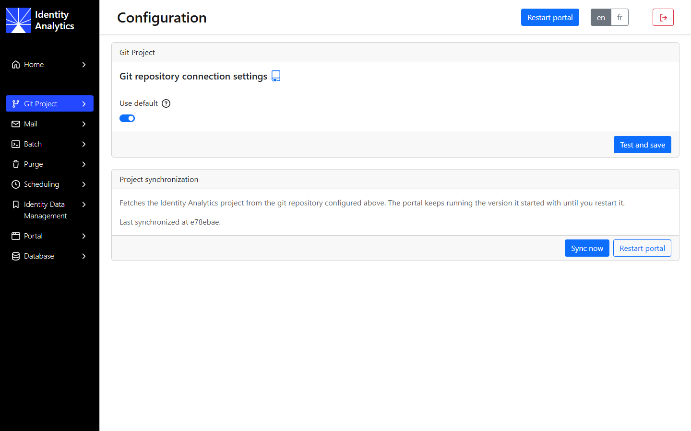

# Project changes

When you update the project (for example, in iGRC Studio) and push your changes to the branch tracked by the instance, the changes take effect in two stages: Git synchronization, followed by an update to the component that uses the project.

## How the project reaches the instance

| Component | When it takes the project |
| :-------- | :------------------------ |
| `git-server` | Fetches the branch on a schedule, every hour on the hour by default (`0 * * * *`), and at each installation or upgrade of the chart. It keeps a copy of each synchronized commit. |
| Batch (execution plans) | At the start of each execution plan, it downloads the last synchronized commit. A new plan always uses the latest synchronized project. |
| Portal | At the startup of the `portal` pod only. A running portal keeps the project it started with. |

The synchronization schedule is taken from `gitServer.defaultCron` at the first installation only: changing this value later has no effect on an existing instance.

## Apply a change

1. Push the change to the branch of the instance (`git.default.branch`).
2. Wait for the next synchronization, or trigger it now (see below).
3. Execution plans started after the synchronization use the new project: nothing else to do for the data collection.
4. If the change affects the portal (pages, views, reports, rules displayed in the portal), restart the portal: in the configuration interface, click **Restart portal** in the header and confirm, or run:

    ```bash
    kubectl rollout restart statefulset/portal -n <IDA_NAMESPACE>
    kubectl rollout status statefulset/portal -n <IDA_NAMESPACE>
    ```

    If the workflow component is enabled, restart the `workflow` statefulset in the same way: it reads the project like the portal.

## Trigger a synchronization now

In the configuration interface, open **Git Project** and click **Sync now**.



Running `helm upgrade` of the instance again, with the same values, triggers an immediate synchronization when the Git settings come from the values (**Use default** selected in the configuration interface). If the configuration service does not answer at that moment, the synchronization fails and is retried 10 minutes later: a new request during these 10 minutes does not start it earlier. Check the result with `/api/sync/latest` (below).

You can also call the API of `git-server` from your workstation:

```bash
kubectl port-forward -n <IDA_NAMESPACE> svc/git-server 8080:80
# in another terminal
curl -s -X POST http://localhost:8080/api/sync/now
# returns a message and the id of the synchronization job
curl -s http://localhost:8080/api/sync/latest
# returns the last synchronized commit (git_hash)
```

Compare `git_hash` with the last commit of your branch to check that the change has been synchronized. If the synchronization fails, check the logs of the `git-server` pod (`kubectl logs -n <IDA_NAMESPACE> git-server-0`): a wrong branch or expired credentials are the usual causes.
